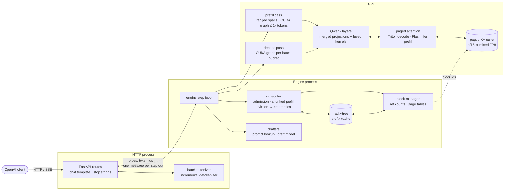
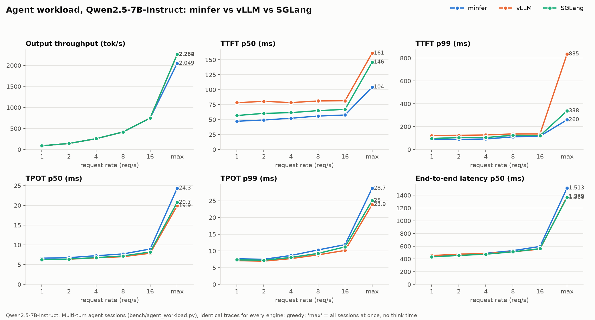
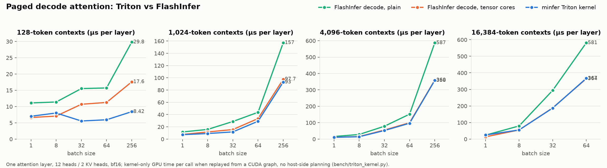

# minfer

**minfer is a from-scratch LLM inference engine built for multi-turn agent workloads.**
Agents resend almost everything they have already sent: the same system prompt and tool
schemas on every request, and the whole conversation so far on every turn. minfer is
organized around that fact — a paged KV cache whose blocks are shared between requests
through a radix tree keyed on token prefixes, a scheduler that admits the requests whose
prefixes are already cached, and continuous batching with CUDA-graph execution around it.
It is a pure-PyTorch implementation of Qwen2.5 with its own Triton kernels (paged decode
attention, fused norm/RoPE/activation) next to FlashInfer's, an OpenAI-compatible server,
and a benchmark suite that compares it with vLLM and SGLang on identical traces. It is
not a wrapper around another serving engine.

> Phase-by-phase status with each acceptance result: [PROGRESS.md](PROGRESS.md).
> Every design decision, bug, root cause and measurement: [DESIGN.md](DESIGN.md).

## Headline result

<!-- BEGIN headline -->
On the multi-turn agent workload at 1–16 req/s (Qwen2.5-1.5B-Instruct, bf16, one H100, greedy, identical traces):

| | minfer | vLLM | SGLang |
|---|---|---|---|
| TTFT p50 (ms) | 38–41 | 59–63 | 44–47 |
| TTFT p99 (ms) | 68–82 | 95–122 | 78–114 |
| TPOT p50 (ms) | 2.54–2.99 | 2.25–2.40 | 2.25–2.57 |
| prefix-cache hit rate | 93.0%–93.6% | 92.6%–93.2% | 93.1%–93.7% |
| saturated output tok/s ("max") | 4219 | 5106 | 5049 |
| TTFT p50 relative to vLLM | 0.64–0.66× | 1.00× | 0.71–0.79× |
| TPOT p50 relative to vLLM | 1.06–1.24× | 1.00× | 0.94–1.07× |
| saturated tok/s relative to vLLM | 0.83× | 1.00× | 0.99× |
| saturated TTFT p50 / p99 (ms) | 83 / 241 | 144 / 570 | 119 / 460 |
<!-- END headline -->

**minfer answers first.** It has the lowest time-to-first-token of the three engines at
every request rate on the agent workload, at the median and at the 99th percentile, and
keeps that lead when saturated. All three engines reuse the same share of prompt tokens (hit-rate row) —
on this workload their prefix caches are equally effective — so the TTFT lead is not a
better hit rate; it is a shorter path from socket to first token for a request that is
mostly cache hits. A [fairness audit](#fairness-audit) took that path apart: when clients
send token ids instead of text, minfer's lead over vLLM is unchanged (16 vs 36 ms) but its
lead over SGLang shrinks from about 10 ms to about 3 ms, and disappears at the median when
saturated. Against SGLang, most of the lead is therefore the HTTP front end (batched
tokenization off the event loop), not the engine; against vLLM it is the engine path
(block-sharing admission with no copy, and a CUDA-graph prefill pass for the few hundred
tokens that are actually new).

**It does not generate fastest.** Per-token latency is behind vLLM at every rate and
close to SGLang's, and saturated throughput is below both (ratios in the last rows of the
table). End-to-end latency for a turn comes out about even at low rates and behind at high
rates. The sections below show exactly where, and why. The audit also found that SGLang
with its batch tokenizer enabled — a documented flag these tables were measured without —
reaches 5,780 tok/s saturated, which puts minfer at 0.73× of the best baseline rather than
the 0.83× shown here.

## Architecture



How a request flows:

1. The HTTP process applies the chat template, tokenizes (batched, off the event loop) and
   sends token ids to the engine process over a pipe.
2. The scheduler looks the prompt up in the radix tree. Blocks for the longest cached
   prefix are *shared* into the request's page table (a reference count, no copy); only the
   remaining tokens are prefilled, in chunks interleaved with other requests' decode steps.
3. Each engine step runs at most one ragged prefill pass and one fixed-shape decode pass,
   both replayed from CUDA graphs when their shape fits a bucket. Blocks are published to
   the radix tree as soon as they are full, so a second request with the same prefix can
   hit while the first is still running.
4. Under memory pressure the cache gives back least-recently-used leaves before any
   running request is preempted; preempted requests are recomputed later (usually from the
   cache).
5. Tokens stream back one message per engine step and are detokenized incrementally into
   SSE chunks.

| Component | Where | Notes |
|---|---|---|
| Qwen2 forward pass, safetensors loading | `minfer/model/` | verified against `transformers` (fp32 max abs logit diff 8e-5); fused path in `fused.py` |
| Block manager, paged KV store | `minfer/cache/` | 16-token blocks, ref counts, O(1) evictable count, optional mixed-precision FP8 |
| Radix-tree prefix cache | `minfer/cache/radix_tree.py` | block-aligned edges, split on divergence, LRU leaf eviction |
| Scheduler | `minfer/scheduler/` | cache-aware admission with starvation guard, chunked prefill, preemption by recompute |
| Attention | `minfer/attention/` | Triton paged decode kernel, FlashInfer prefill, CUDA graphs for decode and prefill |
| Speculative decoding | `minfer/spec/` | prompt-lookup and draft-model drafters; exact for greedy, unbiased for sampling |
| Tensor parallelism | `minfer/parallel/` | Megatron-style shards, head-sharded KV cache (CPU-verified only) |
| FP8 | `minfer/quant/` | E4M3 weights + activations; E4M3 KV cache with calibrated scales |
| Server | `minfer/server/` | OpenAI-compatible; engine in its own process |
| Benchmarks | `bench/` | agent workload generator + replay client, three-engine matrix, ablations, plots |

## Results

All numbers below are generated from the JSON files in [`bench/results/`](bench/results) by
[`bench/readme_tables.py`](bench/readme_tables.py); none is typed by hand
(`python -m bench.readme_tables --check` fails if this file is stale). Hardware and
software versions are in [`bench/ENV.md`](bench/ENV.md): one H100 80GB, vLLM 0.34.0,
SGLang 0.5.23, PyTorch 2.14, FlashInfer 0.7.3.

### Agent workload: minfer vs vLLM vs SGLang

Multi-turn agent sessions ([`bench/agent_workload.py`](bench/agent_workload.py): three
agent types, ~4k-token system prompts with JSON tool schemas, 5–15 turns, tool results
appended every turn; prompts of 4k–14k tokens, outputs of 33–240 tokens), replayed from
identical traces against each server. Greedy decoding, same model and dtype
(Qwen2.5-1.5B-Instruct, bf16), one server at a time, every engine at its defaults with
prefix caching on (the baselines' tuning flags were measured afterwards: see
[Fairness audit](#fairness-audit)). Rate is the nominal request rate; "max" starts 64 sessions at once with
no think time. A value is bold when it is the best of the three at the printed precision.

<!-- BEGIN agent-results -->
| rate (req/s) | engine | out tok/s | TTFT p50 (ms) | TTFT p99 (ms) | TPOT p50 (ms) | TPOT p99 (ms) | E2E p50 (ms) | E2E p99 (ms) | prefix hit rate | failed |
|---|---|---|---|---|---|---|---|---|---|---|
| 1 | minfer | 89 | **39.4** | **71.3** | 2.54 | 2.98 | 191 | 615 | 93.6% | 0 |
|  | vLLM | 89 | 61.6 | 101.6 | 2.39 | 3.04 | 204 | 584 | 93.2% | 0 |
|  | SGLang | 89 | 43.7 | 77.5 | **2.25** | **2.60** | **177** | **548** | **93.7%** | 0 |
| 2 | minfer | 146 | **39.3** | **68.5** | 2.57 | 3.02 | 199 | 659 | 93.1% | 0 |
|  | vLLM | 146 | 59.3 | 101.7 | 2.31 | 2.96 | 213 | 618 | 92.8% | 0 |
|  | SGLang | 146 | 46.6 | 83.4 | **2.26** | **2.83** | **193** | **572** | **93.2%** | 0 |
| 4 | minfer | 270 | **38.3** | **71.2** | 2.65 | 3.15 | 197 | 547 | 93.1% | 0 |
|  | vLLM | 269 | 59.3 | 95.4 | **2.25** | 2.90 | 196 | 517 | 92.7% | 0 |
|  | SGLang | 270 | 46.6 | 94.2 | 2.32 | **2.86** | **190** | **485** | **93.2%** | 0 |
| 8 | minfer | 445 | **40.7** | **77.1** | 2.82 | 3.56 | 215 | 635 | 93.0% | 0 |
|  | vLLM | 447 | 62.9 | 118.3 | **2.29** | **3.17** | 210 | **548** | 92.6% | 0 |
|  | SGLang | **448** | 46.5 | 99.8 | 2.43 | 3.21 | **201** | 571 | **93.1%** | 0 |
| 16 | minfer | 799 | **41.1** | **82.3** | 2.99 | 4.20 | 225 | 703 | 93.2% | 0 |
|  | vLLM | 802 | 62.1 | 122.2 | **2.40** | **3.15** | 210 | **605** | 92.8% | 0 |
|  | SGLang | 802 | 45.6 | 114.4 | 2.57 | 3.52 | **208** | 618 | **93.3%** | 0 |
| max | minfer | 4219 | **83.1** | **240.9** | 10.71 | 12.59 | 705 | 2345 | 92.8% | 0 |
|  | vLLM | **5106** | 144.2 | 569.7 | **7.40** | **9.88** | **635** | 1739 | 92.5% | 0 |
|  | SGLang | 5049 | 119.2 | 459.9 | 8.08 | 10.81 | 646 | **1651** | **92.9%** | 0 |
<!-- END agent-results -->



### ShareGPT (control workload)

Single-turn chat requests with little shared prefix, driven by vLLM's own benchmark client
(`vllm bench serve`). This workload does not play to minfer's design; it shows what the
engine does when there is nothing to reuse, measured by a client this repository did not
write.

<!-- BEGIN sharegpt-results -->
| rate (req/s) | engine | out tok/s | TTFT p50 (ms) | TTFT p99 (ms) | TPOT p50 (ms) | TPOT p99 (ms) | E2E p50 (ms) | E2E p99 (ms) | failed |
|---|---|---|---|---|---|---|---|---|---|
| 1 | minfer | 215 | **10.7** | **20.5** | 2.24 | 2.52 | **370** | 1720 | 0 |
|  | vLLM | 215 | 23.7 | 43.3 | **2.16** | 3.49 | 391 | **1707** | 0 |
|  | SGLang | 215 | 19.3 | 99.0 | 2.18 | **2.48** | 372 | 1730 | 0 |
| 2 | minfer | 429 | **9.9** | **14.3** | 2.28 | **2.43** | **374** | 1777 | 0 |
|  | vLLM | 428 | 21.5 | 34.9 | **2.16** | 3.78 | 384 | **1712** | 0 |
|  | SGLang | 429 | 28.8 | 45.5 | 2.25 | 2.82 | 394 | 1868 | 0 |
| 4 | minfer | 857 | **11.2** | **17.9** | 2.34 | **2.61** | 386 | 1828 | 0 |
|  | vLLM | 857 | 23.2 | 41.4 | **2.17** | 3.46 | **367** | **1729** | 0 |
|  | SGLang | 857 | 24.2 | 38.0 | 2.32 | 3.28 | 397 | 1845 | 0 |
| 8 | minfer | 1740 | **11.4** | **19.2** | 2.42 | 2.71 | 430 | 1883 | 0 |
|  | vLLM | 1740 | 25.3 | 45.9 | **2.21** | **2.58** | **417** | **1753** | 0 |
|  | SGLang | 1740 | 25.6 | 47.6 | 2.42 | 3.51 | 459 | 1965 | 0 |
| 16 | minfer | 3210 | **11.8** | **21.7** | 2.55 | 3.36 | 399 | 2023 | 0 |
|  | vLLM | **3212** | 29.3 | 55.7 | **2.28** | **2.61** | **380** | **1825** | 0 |
|  | SGLang | 3209 | 27.7 | 50.4 | 2.63 | 4.55 | 428 | 2233 | 0 |
| max | minfer | **24607** | 2764.3 | 5502.4 | **6.68** | **8.76** | **4246** | **7637** | 0 |
|  | vLLM | 22248 | **1505.2** | 4245.6 | 24.40 | 62.67 | 5682 | 9039 | 0 |
|  | SGLang | 16102 | 2233.2 | **2571.0** | 35.33 | 197.03 | 7417 | 12464 | 0 |
<!-- END sharegpt-results -->


### Fairness audit

The tables above run every engine at its defaults. That is a rule a reviewer can fairly
object to, so the comparison was audited ([`bench/fairness_audit.py`](bench/fairness_audit.py);
every setting of the three servers is listed side by side in DESIGN.md D-038). Each
baseline was re-measured with the flags its documentation offers for a latency-sensitive,
prefix-heavy workload, on the same traces, and all three engines were measured once more
with the prompts sent as token ids, which takes server-side tokenization out of the path.

<!-- BEGIN fairness-audit -->
| engine / configuration | flags added to the defaults | 4 req/s: TTFT p50 / p99 (ms) | 4 req/s: TPOT p50 / p99 (ms) | 16 req/s: TTFT p50 / p99 (ms) | 16 req/s: TPOT p50 / p99 (ms) | max: tok/s | max: TTFT p50 / p99 (ms) | max: TPOT p50 / p99 (ms) |
|---|---|---|---|---|---|---|---|---|
| minfer / default | — | 39 / 67 | 2.64 / 3.15 | 40 / 82 | 2.99 / 4.18 | 4211 | 84 / 258 | 10.99 / 12.74 |
| vLLM / default | — | 62 / 99 | 2.38 / 2.96 | 64 / 127 | 2.54 / 3.39 | 4987 | 157 / 644 | 7.61 / 9.75 |
| vLLM / no access log | `--disable-uvicorn-access-log` | 63 / 95 | 2.40 / 3.09 | 65 / 119 | 2.49 / 3.18 | 4937 | 158 / 727 | 7.47 / 9.22 |
| vLLM / xxhash | `--prefix-caching-hash-algo` `xxhash` | 58 / 101 | 2.38 / 3.00 | 66 / 130 | 2.54 / 3.39 | 4954 | 149 / 709 | 7.58 / 9.39 |
| vLLM / interactivity | `--performance-mode` `interactivity` | 61 / 99 | 2.39 / 3.22 | 65 / 124 | 2.46 / 3.35 | 4917 | 173 / 744 | 7.39 / 9.58 |
| vLLM / throughput | `--performance-mode` `throughput` | 63 / 103 | 2.40 / 3.42 | 66 / 126 | 2.55 / 3.40 | 4899 | 133 / 737 | 7.78 / 9.54 |
| SGLang / default | — | 49 / 95 | 2.32 / 3.03 | 50 / 114 | 2.60 / 3.48 | 5071 | 103 / 453 | 8.33 / 10.77 |
| SGLang / lpm | `--schedule-policy` `lpm` | 49 / 94 | 2.34 / 3.07 | 48 / 130 | 2.60 / 3.55 | 5021 | 122 / 465 | 8.11 / 10.60 |
| SGLang / batch tokenizer | `--enable-dynamic-batch-tokenizer` | 48 / 86 | 2.36 / 2.72 | 55 / 107 | 2.59 / 3.18 | 5796 | 116 / 402 | 6.83 / 8.27 |
| SGLang / mixed chunk | `--enable-mixed-chunk` | 49 / 95 | 2.33 / 3.05 | 48 / 122 | 2.48 / 3.43 | 5131 | 308 / 540 | 5.69 / 7.73 |
| SGLang / torch compile | `--enable-torch-compile` | 141 / 193 | 69.87 / 70.87 | 132 / 214 | 40.10 / 72.23 | 1225 | 120 / 472 | 9.00 / 70.78 |
| minfer / token ids | (prompts sent as token ids) | 16 / 34 | 2.65 / 3.23 | 17 / 32 | 2.98 / 4.28 | 4214 | 33 / 216 | 11.50 / 13.56 |
| vLLM / token ids | (prompts sent as token ids) | 36 / 68 | 2.39 / 3.14 | 36 / 87 | 2.52 / 3.26 | 5207 | 88 / 406 | 8.34 / 9.93 |
| SGLang / token ids | (prompts sent as token ids) | 19 / 30 | 2.35 / 2.77 | 20 / 35 | 2.60 / 3.33 | 5569 | 31 / 346 | 8.61 / 10.09 |
| vLLM / tuned | `--disable-uvicorn-access-log` | 62 / 100 | 2.40 / 3.03 | 64 / 126 | 2.56 / 3.55 | 4979 | 125 / 651 | 7.75 / 9.63 |
| SGLang / tuned | `--enable-dynamic-batch-tokenizer` | 48 / 83 | 2.36 / 2.72 | 53 / 105 | 2.61 / 3.28 | 5780 | 113 / 373 | 6.83 / 8.20 |
<!-- END fairness-audit -->

What the audit changed:

- **vLLM's defaults are already its best configuration here.** No flag moved its numbers
  beyond the spread of its own repeated runs. It was the only server writing an access-log
  line per request; that is now off, for parity, with no measurable effect.
- **SGLang gains 14% saturated throughput from its batch tokenizer**
  (`--enable-dynamic-batch-tokenizer`), which the published tables did not give it. With
  it SGLang is the fastest of the three at saturation and minfer's deficit there is 0.73×,
  not 0.83×. Benchmarks from here on run SGLang with that flag. Its `torch.compile` mode,
  the other documented candidate, was several times slower on this workload.
- **minfer's TTFT lead survives against the tuned baselines** (39–40 ms vs 62–64 ms and
  48–53 ms at 4–16 req/s) **but it is not all engine.** With token-id prompts the three
  engines' TTFT is 16–17, 36 and 19–20 ms, and when saturated SGLang's median (31 ms) is
  level with minfer's (33 ms). About two thirds of the lead over SGLang on text prompts
  comes from how the front ends tokenize a 25 KB prompt; the lead over vLLM is in the
  engine path either way.
- **The Triton decode kernel's published speed-up over FlashInfer was against the wrong
  baseline**; see [Component measurements](#component-measurements).

### Where minfer loses to vLLM and SGLang, and why

minfer is behind in three places, all visible in the tables above.

1. **Time per output token, at every rate.** A decode step is a replayed CUDA graph whose
   cost at small batch sizes is the number of kernels it launches. Phase 11 cut that to
   about a third (profile table below), which closed most of what was a 2× gap, but vLLM
   compiles the model with `torch.compile` and SGLang uses a longer list of fused
   operators, and both still launch fewer. What remains in minfer's step: the K/V write
   (two scatter kernels per layer), the unmerged output projections, and host work in the
   scheduler and radix tree.
2. **Saturated throughput on the agent workload.** With 64 sessions running flat out,
   almost every engine step both admits a request and decodes. minfer runs those as two
   passes over the weights (a ragged prefill pass and a fixed-shape decode pass — the
   design that makes the decode graphs simple); vLLM runs one mixed batch. Large prefill
   passes also still run eagerly rather than from a graph.
3. **Queueing at extreme concurrency on ShareGPT.** With every request submitted at once
   ("max") minfer has the highest throughput and the lowest per-token latency, but the
   worst median TTFT of the three: it caps the number of running sequences and queues the
   rest,
   where the other engines admit more requests at once and pay for it in per-token latency
   instead. That is a default (`--max-num-seqs`), not a measured optimum.

Two more caveats belong here. The comparison is one model (1.5B parameters) on one GPU: a
larger model shifts time from kernel launches to matmuls, where none of minfer's
advantages or disadvantages above necessarily hold. And the agent traces use scripted
assistant turns so that every engine sees identical prompts; a live agent loop re-sends
the model's own output, which this benchmark cannot credit any engine for caching.

### Ablations

The agent workload against `minfer serve` with one feature changed at a time
([`bench/ablations.py`](bench/ablations.py)). The first row is the default system; the
last rows constrain the engine so that the scheduling features have decisions to make.

<!-- BEGIN ablations -->
| configuration | flags | 16 req/s: tok/s | TTFT p50 / p99 (ms) | TPOT p50 / p99 (ms) | hit rate | max: tok/s | TTFT p50 / p99 (ms) | TPOT p50 / p99 (ms) | hit rate |
|---|---|---|---|---|---|---|---|---|---|
| full system (defaults) | — | 800 | 37 / 86 | 2.98 / 4.24 | 93.2% | 4208 | 83 / 234 | 11.08 / 12.83 | 92.8% |
| − prefix cache | `--no-prefix-cache` | 762 | 109 / 438 | 6.21 / 17.72 | — | 1204 | 1715 / 2486 | 18.39 / 20.32 | — |
| − cache-aware admission (FCFS) | `--no-cache-aware-scheduling` | 797 | 38 / 79 | 2.96 / 4.24 | 93.2% | 4298 | 76 / 147 | 10.97 / 12.18 | 92.8% |
| − CUDA graphs (decode and prefill) | `--no-cuda-graphs` | 752 | 47 / 338 | 7.90 / 17.48 | 93.2% | 3361 | 73 / 270 | 13.07 / 14.64 | 92.8% |
| − prefill graphs only | `--no-prefill-graphs` | 798 | 40 / 86 | 3.13 / 4.64 | 93.2% | 4042 | 75 / 270 | 11.64 / 13.78 | 92.8% |
| − chunked prefill | `--no-chunked-prefill` | 800 | 37 / 80 | 2.98 / 4.25 | 93.2% | 4257 | 76 / 223 | 11.08 / 12.64 | 92.8% |
| − fused kernels | `--no-fused-kernels` | 780 | 43 / 89 | 5.05 / 6.71 | 93.2% | 3207 | 78 / 266 | 14.81 / 16.85 | 92.8% |
| − Triton decode (FlashInfer decode) | `--decode-kernel` `flashinfer` | 798 | 38 / 77 | 3.21 / 4.45 | 93.2% | 3485 | 69 / 241 | 14.03 / 16.93 | 92.8% |
| + speculation: prompt lookup | `--speculation` `ngram` | 779 | 43 / 87 | 5.55 / 10.49 | 93.2% | 3297 | 76 / 241 | 13.19 / 21.90 | 92.8% |
| + speculation: draft model | `--speculation` `draft` | 731 | 75 / 124 | 11.72 / 18.97 | 93.2% | 1852 | 141 / 424 | 22.29 / 39.75 | 92.8% |
| + FP8 KV cache | `--kv-cache-dtype` `fp8` | 791 | 43 / 87 | 4.19 / 6.00 | 93.2% | 2646 | 78 / 264 | 19.46 / 23.32 | 92.8% |
| + FP8 weights | `--weight-dtype` `fp8` | 765 | 49 / 97 | 6.88 / 11.27 | 93.2% | 2572 | 80 / 254 | 18.91 / 21.66 | 92.8% |
| 16 running sequences max | `--max-num-seqs` `16` | 800 | 37 / 81 | 2.97 / 4.25 | 93.2% | 2848 | 1081 / 1649 | 5.17 / 7.80 | 92.8% |
| 16 running sequences max, FCFS | `--max-num-seqs` `16` `--no-cache-aware-scheduling` | 799 | 40 / 79 | 2.96 / 4.19 | 93.2% | 2942 | 970 / 1204 | 5.08 / 7.21 | 92.8% |
| KV cache 8% of GPU memory | `--kv-memory-fraction` `0.08` | 800 | 39 / 85 | 3.04 / 4.23 | 93.2% | 4054 | 81 / 252 | 11.21 / 15.18 | 92.1% |
| KV cache 8%, FCFS | `--kv-memory-fraction` `0.08` `--no-cache-aware-scheduling` | 799 | 38 / 78 | 3.01 / 4.36 | 93.2% | 4128 | 74 / 228 | 11.42 / 14.69 | 92.3% |
| KV cache 8%, FP8 KV | `--kv-memory-fraction` `0.08` `--kv-cache-dtype` `fp8` | 791 | 43 / 91 | 4.22 / 6.37 | 93.2% | 2679 | 76 / 293 | 19.09 / 21.12 | 92.8% |
| KV cache 8%, no prefix cache | `--kv-memory-fraction` `0.08` `--no-prefix-cache` | 764 | 106 / 317 | 6.33 / 17.82 | — | 1201 | 1714 / 2512 | 18.39 / 20.25 | — |
<!-- END ablations -->

Reading the table:

- **The prefix cache is what the engine is for.** Turning it off costs a factor of several
  in saturated throughput and in time-to-first-token (second row), and the same again when
  memory is tight (last row).
- **The execution-path work matters next**: fused kernels, CUDA graphs and the Triton
  decode kernel each account for a visible share of per-token latency and throughput.
- **Cache-aware admission shows no benefit in any scenario measured** — within noise with
  the default limits, and slightly worse than FCFS when a queue is forced. Every waiting
  request on this workload already has a long cached prefix, so the policy has little to
  choose between. It stays as an option; this result is the honest status of the feature.
- **Chunked prefill is neutral on this workload** (cache hits leave only a few hundred new
  tokens per request, below the chunk size). Its trade-off on long uncached prompts is in
  the chunked-prefill table below.
- **Speculation and FP8 make this engine slower per token** (sections below).

### Component measurements

**Decode step, one optimization at a time** (wall-clock time of an engine step in
steady-state decode; [`bench/decode_latency.py`](bench/decode_latency.py)):

<!-- BEGIN decode-latency -->
| batch | context (tokens) | eager (ms) | + CUDA graphs (ms) | + Triton decode (ms) | + fused kernels (default) (ms) | eager → default |
|---|---|---|---|---|---|---|
| 1 | 256 | 10.95 | 3.74 | 3.52 | 2.17 | 5.0× |
| 2 | 256 | 10.97 | 3.95 | 3.71 | 2.23 | 4.9× |
| 4 | 256 | 11.04 | 4.00 | 3.80 | 2.25 | 4.9× |
| 8 | 256 | 11.07 | 4.21 | 3.95 | 2.33 | 4.7× |
| 16 | 256 | 11.06 | 4.34 | 4.07 | 2.37 | 4.7× |
| 32 | 256 | 11.20 | 4.67 | 4.29 | 2.51 | 4.5× |
| 64 | 256 | 11.35 | 5.11 | 4.67 | 2.80 | 4.1× |
| 128 | 256 | 11.55 | 5.92 | 5.33 | 3.35 | 3.4× |
| 256 | 256 | 11.80 | 7.54 | 6.70 | 4.54 | 2.6× |
| 1 | 2048 | 10.89 | 3.84 | 3.61 | 2.27 | 4.8× |
| 2 | 2048 | 11.01 | 4.05 | 3.81 | 2.34 | 4.7× |
| 4 | 2048 | 11.09 | 4.13 | 3.94 | 2.39 | 4.6× |
| 8 | 2048 | 11.06 | 4.47 | 4.17 | 2.52 | 4.4× |
| 16 | 2048 | 11.18 | 4.99 | 4.44 | 2.72 | 4.1× |
| 32 | 2048 | 11.27 | 5.53 | 4.94 | 3.19 | 3.5× |
| 64 | 2048 | 11.48 | 7.00 | 5.98 | 4.07 | 2.8× |
| 128 | 2048 | 11.99 | 9.84 | 7.93 | 5.98 | 2.0× |
| 256 | 2048 | 17.90 | 15.97 | 12.24 | 10.33 | 1.7× |
<!-- END decode-latency -->


**What the profiler showed** ([`bench/profile_engine.py`](bench/profile_engine.py), traces
in `bench/results/profiles/`): the decode step was bound by kernel count. "Before" is the
engine without fused kernels, Triton decode or prefill graphs.

<!-- BEGIN profile -->
| scenario | CUDA kernels/step before | after | GPU ms/step before | after |
|---|---|---|---|---|
| decode graph batch1 | 1219 | 398 | 3.63 | 2.03 |
| decode graph batch64 | 1219 | 399 | 5.11 | 2.58 |
| decode eager batch1 | 1219 | 398 | 3.75 | 2.04 |
| prefill 2048 tokens | 1248 | 399 | 15.56 | 10.98 |
<!-- END profile -->

**One prefill pass** ([`bench/prefill_latency.py`](bench/prefill_latency.py)): an eager
pass costs about the same Python dispatch time whatever its size; fused kernels, and a
CUDA graph for the smaller passes, remove most of it.

<!-- BEGIN prefill-latency -->
| prompt tokens | eager (ms) | eager + fused kernels (ms) | default (ms) | speedup |
|---|---|---|---|---|
| 16 | 10.91 | 6.86 | 2.38 | 4.6× |
| 64 | 10.86 | 6.93 | 2.61 | 4.2× |
| 256 | 10.73 | 6.93 | 3.53 | 3.0× |
| 512 | 10.69 | 6.93 | 4.47 | 2.4× |
| 1024 | 11.39 | 7.19 | 7.09 | 1.6× |
| 2048 | 17.74 | 12.29 | 12.34 | 1.4× |
<!-- END prefill-latency -->

**Triton paged-attention decode kernel vs FlashInfer's**
([`bench/triton_kernel.py`](bench/triton_kernel.py)). *Kernel only* is GPU time per layer
when the kernel is replayed from a CUDA graph (no Python launcher, no host-side planning);
*step* is one decode step's worth of attention in wall-clock time, host preparation
included (FlashInfer's `plan()`, or the Triton path's page-table copy) plus 28 layers.
FlashInfer has two decode configurations; the comparison is against the faster one.

<!-- BEGIN triton -->
| batch | context | FlashInfer, plain (µs/layer) | FlashInfer, tensor cores (µs/layer) | Triton (µs/layer) | kernel only: Triton vs best FlashInfer | step: FlashInfer plan + 28 layers (ms) | step: Triton prep + 28 layers (ms) | end to end: Triton vs FlashInfer | max abs difference |
|---|---|---|---|---|---|---|---|---|---|
| 1 | 128 | 11.1 | 6.6 | 7.0 | 0.94× | 0.22 | 0.21 | 1.04× | 0.0020 |
| 8 | 128 | 11.4 | 7.1 | 8.0 | 0.88× | 0.24 | 0.24 | 0.97× | 0.0020 |
| 32 | 128 | 15.5 | 10.7 | 5.6 | 1.92× | 0.34 | 0.17 | 1.95× | 0.0039 |
| 64 | 128 | 15.7 | 11.3 | 5.9 | 1.90× | 0.35 | 0.18 | 1.91× | 0.0039 |
| 256 | 128 | 29.8 | 17.6 | 8.4 | 2.09× | 0.53 | 0.25 | 2.09× | 0.0039 |
| 1 | 1,024 | 11.6 | 7.5 | 7.2 | 1.05× | 0.25 | 0.22 | 1.14× | 0.0010 |
| 8 | 1,024 | 15.7 | 11.6 | 9.0 | 1.29× | 0.36 | 0.27 | 1.33× | 0.0010 |
| 32 | 1,024 | 28.7 | 15.5 | 11.7 | 1.33× | 0.47 | 0.35 | 1.36× | 0.0010 |
| 64 | 1,024 | 43.7 | 33.5 | 29.1 | 1.15× | 0.98 | 0.83 | 1.17× | 0.0010 |
| 256 | 1,024 | 157.2 | 97.7 | 93.0 | 1.05× | 2.79 | 2.63 | 1.06× | 0.0020 |
| 1 | 4,096 | 15.5 | 11.2 | 10.9 | 1.03× | 0.35 | 0.32 | 1.10× | 0.0005 |
| 8 | 4,096 | 28.0 | 15.2 | 14.2 | 1.08× | 0.46 | 0.42 | 1.12× | 0.0005 |
| 32 | 4,096 | 78.2 | 54.9 | 52.0 | 1.06× | 1.58 | 1.48 | 1.07× | 0.0005 |
| 64 | 4,096 | 151.8 | 99.5 | 96.5 | 1.03× | 2.83 | 2.72 | 1.04× | 0.0005 |
| 256 | 4,096 | 586.9 | 359.6 | 357.7 | 1.01× | 10.13 | 10.02 | 1.01× | 0.0005 |
| 1 | 16,384 | 23.6 | 13.4 | 24.7 | 0.54× | 0.41 | 0.71 | 0.58× | 0.0002 |
| 8 | 16,384 | 79.2 | 55.1 | 54.9 | 1.00× | 1.59 | 1.56 | 1.02× | 0.0002 |
| 32 | 16,384 | 294.2 | 188.3 | 187.3 | 1.01× | 5.32 | 5.27 | 1.01× | 0.0002 |
| 64 | 16,384 | 581.3 | 364.3 | 366.8 | 0.99× | 10.26 | 10.30 | 1.00× | 0.0002 |

Kernel only, against the faster FlashInfer configuration, the Triton kernel is 0.54–2.09× as fast: more than 5% faster at 9 of 19 points, more than 5% slower at 3, within 5% at 7. End to end (host preparation included) it is 0.58–2.09×.
<!-- END triton -->



An earlier version of this table reported the Triton kernel as 1.35–3.5× faster at 18 of
19 points. That compared it with FlashInfer's plain decode path; for this head layout
FlashInfer's tensor-core path (the one SGLang selects) is faster everywhere, and against
it the honest summary is the sentence under the table: a clear win only for many
sequences with short contexts, parity from 4k-token contexts up, and a loss at batch 1
with a very long context. minfer's own FlashInfer decode option now uses the tensor-core
path too.

**Chunked prefill** on a mixed long/short workload
([`bench/chunked_prefill.py`](bench/chunked_prefill.py)): smaller chunks bound the stalls
that long prompts inflict on running streams (ITL = inter-token latency), and cost
time-to-first-token.

<!-- BEGIN chunked-prefill -->
| chunk (tokens) | ITL p99 (ms) | ITL max (ms) | TPOT p50 (ms) | TPOT p99 (ms) | long-prompt TTFT p50 (ms) | out tok/s |
|---|---|---|---|---|---|---|
| off | 5.6 | 114 | 2.45 | 5.00 | 69 | 1703 |
| 4096 | 25.0 | 41 | 2.45 | 5.31 | 82 | 1702 |
| 2048 | 17.7 | 26 | 2.45 | 5.47 | 100 | 1700 |
| 1024 | 12.8 | 26 | 2.51 | 5.89 | 121 | 1697 |
| 512 | 11.9 | 14 | 2.58 | 9.29 | 208 | 1687 |
| 256 | 10.8 | 14 | 3.04 | 9.54 | 462 | 1653 |
<!-- END chunked-prefill -->

**Speculative decoding** ([`bench/speculation.py`](bench/speculation.py)), engine-level,
greedy:

<!-- BEGIN speculation -->
| workload | speculation | out tok/s | vs off | TPOT p50 (ms) | tokens/step | accepted | outputs identical to off |
|---|---|---|---|---|---|---|---|
| agent | off | 3199 | — | 6.54 | 16.6 | — | — |
| agent | ngram | 2483 | 0.78× | 5.21 | 30.4 | 75% | 234/356 |
| agent | draft model | 1413 | 0.44× | 12.23 | 54.3 | 74% | 230/356 |
| sharegpt | off | 35777 | — | 5.05 | 186.8 | — | — |
| sharegpt | ngram | 14832 | 0.41× | 12.25 | 189.3 | 56% | 91/256 |
| sharegpt | draft model | 9809 | 0.27× | 14.89 | 366.2 | 66% | 83/256 |
<!-- END speculation -->

Speculation is implemented correctly and is **a net slowdown on this engine**, so it is
off by default. Most drafted tokens are accepted and steps emit about twice as many tokens,
but a verification span has to run through the eager prefill pass (it needs logits for
every drafted position, which the captured graphs do not provide), and one eager pass
costs more than the few graph-replayed decode steps it replaces. The draft model adds its
own passes on top. In the saturated engine-level run above, prompt lookup does lower the
*median* time per token on the agent workload — agent outputs really do copy from their
prompts — at the cost of total throughput; through the server at moderate load it raises
both (ablation table). Capturing the verification pass in a graph is the missing piece; it
was not done. "Outputs identical to off" is below 100% because bf16 argmax near-ties flip when the
same position is evaluated by a different kernel (see Correctness); on the CPU in float32
the outputs are exactly identical for any draft.

**FP8** ([`bench/gsm8k.py`](bench/gsm8k.py)): GSM8K accuracy on the first 200 test
problems (standard error ±3.3 points), KV capacity in the same memory budget, weight
memory, and decode-step latency.

<!-- BEGIN fp8 -->
| setting | GSM8K (200) | KV capacity | weights | decode step ms (batch 1 / 64 / 256) |
|---|---|---|---|---|
| bf16 | 69.0% | 1.00× | 2.89 GB | 2.16 / 2.95 / 5.31 |
| FP8 KV cache | 68.5% | 1.92× | 2.89 GB | 2.74 / 4.15 / 8.63 |
| FP8 weights | 70.5% | 1.00× | 1.67 GB | 4.42 / 6.92 / 9.62 |
| FP8 weights + KV | 71.0% | 1.91× | 1.67 GB | 5.04 / 8.12 / 12.82 |
<!-- END fp8 -->

FP8 costs no measurable accuracy (all four settings are within one standard error of each
other) and **nearly doubles KV capacity**, but it makes decode steps **slower**, not
faster: a 1.5B model's decode step is bound by kernel count rather than by the bytes its
matmuls read, and FP8 adds kernels (quantizing activations and K/V) while the FP8-weight
path cannot use the fused kernels at all. FP8 is therefore a memory feature here and off by
default — and in the one memory-constrained scenario measured (last ablation rows) the
extra capacity restored the cache hit rate but did not make up for the slower steps.

One finding worth knowing about: an *all*-FP8 KV cache destroyed the model's output
(GSM8K accuracy fell to almost nothing). Layer 0's keys have a few components two orders of
magnitude larger than the rest, and E4M3's 3-bit mantissa turns its 6% relative rounding
error on those into attention-logit errors far above anything a softmax tolerates. No
scale fixes a relative error, so calibration measures each layer's logit error and keeps
the offending layers (for this model: layer 0 only) in bf16 — which is why capacity grows
a little less than 2×. Root-cause analysis and measurements: DESIGN.md B-005.

### Correctness

- **Model.** Float32 logits match Hugging Face `transformers` on five diverse prompts
  (max abs difference 8e-5, `bench/results/model_numerics.json`); the fused-kernel path is
  tested against the reference path kernel by kernel and end to end.
- **Engine vs a cache-free oracle (exact).** On a small float32 model on the CPU, greedy
  engine output is *identical* to recomputing the whole sequence at every step — under
  serial and batched execution, chunked prefill, memory pressure with preemption and
  recompute, the prefix cache with eviction, speculation with drafts of any quality, and
  two-process tensor parallelism. That is what the CPU test-suite (run in CI) asserts.
- **On the GPU in bf16, bit-identical output is not available to any engine.** Greedy
  decoding takes an argmax, and when float32 separates the top two tokens by less than
  bf16 rounding noise the winner depends on kernel and batch shape. vLLM disagrees with
  *itself* between a batched and an unbatched run on about half of 20 prompts. The table
  shows minfer against vLLM, and the prefix cache on against off, next to those noise
  floors; every difference was traced to a float32 near-tie.

<!-- BEGIN equivalence -->
| comparison (greedy, bf16) | result | largest float32 margin at a difference |
|---|---|---|
| minfer vs vLLM, 20 prompts, one request at a time | 11/20 outputs identical | 0.21 |
| minfer (batched) vs vLLM (one at a time) | 10/20 outputs identical | 0.21 |
| **vLLM (batched) vs vLLM (one at a time)** — the noise floor | 9/20 outputs identical | — |
| minfer fed vLLM's tokens (teacher-forced), per position | 1985/2001 tokens equal | 0.30 |
| prefix cache on vs off, 64 agent-style requests | 46/64 outputs identical | 0.13 |
| **cache off vs cache off, different batching** — the noise floor | 46/64 outputs identical | 0.20 |

In the prefix-cache run the cache served 74.7% of prompt tokens and cut the tokens run through the model from 60,572 to 14,302.
<!-- END equivalence -->

- **Tests.** `make test` runs the whole suite on the GPU; the CPU subset (block manager,
  radix tree, scheduler, sampling, engine vs oracle, speculation, tensor parallelism, FP8
  storage, workload generator, server bridge) runs in CI on every push.

## What is not done

- **Tensor parallelism has never run on two GPUs.** The development machine has one H100.
  The implementation is verified with two CPU processes exchanging all-reduces over gloo
  (outputs identical to a single process, KV memory per rank halved); the NCCL path and any
  scaling number for Qwen2.5-14B on 2×H100 do not exist.
- **Modal.** `bench/modal_bench.py` and `deploy/modal_app.py` are written against the
  pinned Modal SDK and import cleanly, but were never run: no credentials. There is no
  hosted endpoint.
- **Reproduction on a second machine was not performed.** A fresh clone on the *same*
  machine, with empty caches and re-downloaded weights, was: see
  [Reproduction check](#reproduction-check).
- **Speculative decoding** is correct but slower than not speculating (above).
- **One model family** (Qwen2/2.5), text only, no tool-call parsing on the response side,
  no `n > 1`, no penalties, no logprobs.

## Reproducing

```bash
git clone https://github.com/visshbala21/minfer && cd minfer
scripts/setup_envs.sh all      # three pinned virtualenvs: minfer, vLLM, SGLang (needs uv)
make test                      # full test suite (GPU + weights); `make test-cpu` is the CI subset
make bench                     # every benchmark above, the plots, and the tables in this file
```

`make bench` needs one H100-class GPU, nvcc on `PATH` (FlashInfer compiles its kernels on
first use) and about three hours; it runs one server at a time. Individual pieces:
`make bench-micro`, `make bench-agent`, `make bench-ablations`, `make plots`. To run it on
a fresh H100 without a local GPU: `modal run bench/modal_bench.py` (written but not
executed from the development machine, which has no Modal credentials).

### Reproduction check

The commands above were run once more from a fresh `git clone` in a new directory, with an
empty `HOME` (no JIT caches for FlashInfer, Triton, vLLM or SGLang) and an empty `HF_HOME`
(weights and datasets downloaded again): the three environments built from the lock files,
`make test` passed (272 tests) and `make bench` ran to completion. It was the same physical
H100, so this checks that the repository is self-contained and how far the numbers move
between two complete runs — not that they carry over to another machine. The tables above
are from the original run; `bench/reproduction.py` compares the two
(`bench/results/reproduction.json`, rerun results in `bench/results/reproduction_rerun/`).

<!-- BEGIN reproduction -->
| agent workload | engine | README run | rerun | rerun / README run |
|---|---|---|---|---|
| TTFT p50, 1–16 req/s (ms) | minfer | 38–41 | 37–41 | 0.94–1.01× |
|  | vLLM | 59–63 | 55–67 | 0.93–1.09× |
|  | SGLang | 44–47 | 47–51 | 1.03–1.10× |
| TTFT p99, 1–16 req/s (ms) | minfer | 68–82 | 65–82 | 0.92–1.06× |
|  | vLLM | 95–122 | 97–140 | 0.95–1.14× |
|  | SGLang | 78–114 | 84–114 | 0.99–1.09× |
| TPOT p50, 1–16 req/s (ms) | minfer | 2.54–2.99 | 2.55–3.02 | 1.00–1.01× |
|  | vLLM | 2.25–2.40 | 2.26–2.39 | 0.98–1.01× |
|  | SGLang | 2.25–2.57 | 2.25–2.57 | 0.99–1.00× |
| TTFT p50, "max" (ms) | minfer | 83 | 79 | 0.95× |
|  | vLLM | 144 | 139 | 0.96× |
|  | SGLang | 119 | 122 | 1.03× |
| TPOT p50, "max" (ms) | minfer | 10.71 | 11.15 | 1.04× |
|  | vLLM | 7.40 | 7.60 | 1.03× |
|  | SGLang | 8.08 | 8.26 | 1.02× |
| output tok/s, "max" | minfer | 4219 | 4215 | 1.00× |
|  | vLLM | 5106 | 5031 | 0.99× |
|  | SGLang | 5049 | 4995 | 0.99× |

- minfer has the lowest TTFT p50 at every rate from 1 to 16 req/s: holds in both runs
- minfer has the lowest TTFT p99 at every rate from 1 to 16 req/s: holds in both runs
- minfer has the lowest TTFT p50 and p99 at saturation: holds in both runs
- minfer's TPOT p50 is higher than vLLM's at every rate: holds in both runs
- minfer's saturated throughput is below vLLM's and SGLang's: holds in both runs
- no request failed for any engine on either workload: **differs** (README run: True, rerun: False)
<!-- END reproduction -->

The one difference in kind: in the rerun SGLang dropped one connection out of 120 in its
ShareGPT run at 1 req/s (the first request of that run took 15 s; nothing in its server
log explains it), where the original run had no failed request for any engine. The
saturated ShareGPT run ("max", 1,000 requests at once) is the least repeatable
measurement here, for the baselines in particular: vLLM's median TTFT was 1.5 s in the
original run and 4.0 s in the rerun, SGLang's throughput 16.1k and 13.6k tok/s; minfer's
moved by 6% and 4%. Treat that row as an order of magnitude.

The agent traces are deterministic: `python -m bench.agent_workload generate --sessions 96
--rate 16 --seed 4 --out trace.jsonl` writes the trace used at 16 req/s, and
`python -m bench.agent_workload replay trace.jsonl --base-url http://host:port` replays it
against any OpenAI-compatible server.

## Serving

```bash
.venv/bin/minfer serve --model Qwen/Qwen2.5-1.5B-Instruct --port 8000
curl localhost:8000/v1/chat/completions -H 'content-type: application/json' \
  -d '{"messages":[{"role":"user","content":"Say hi."}],"max_tokens":16}'
```

Endpoints: `/v1/chat/completions`, `/v1/completions` (SSE streaming on both), `/v1/models`,
`/health`, `/metrics` (Prometheus: throughput, queue depth, prefix-cache hit rate, KV
usage), `/tokenize`, `/detokenize`. Every feature has a flag (`minfer serve --help`):
`--[no-]prefix-cache`, `--[no-]cache-aware-scheduling`, `--[no-]cuda-graphs`,
`--[no-]prefill-graphs`, `--prefill-chunk-tokens N`, `--[no-]fused-kernels`,
`--decode-kernel {auto,triton,flashinfer}`, `--speculation {none,ngram,draft}`,
`--kv-cache-dtype {auto,fp8}`, `--weight-dtype {auto,fp8}`.

`modal deploy deploy/modal_app.py` puts the same server behind a scale-to-zero endpoint on
an H100 (written, not deployed: no Modal credentials on the development machine, so there
is no public endpoint to link to).

## License

MIT — see [LICENSE](LICENSE).
