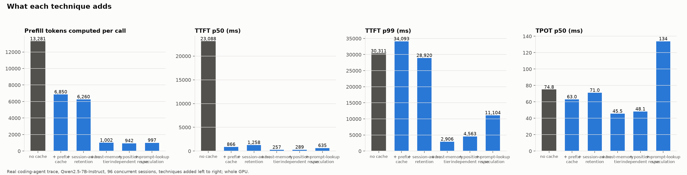
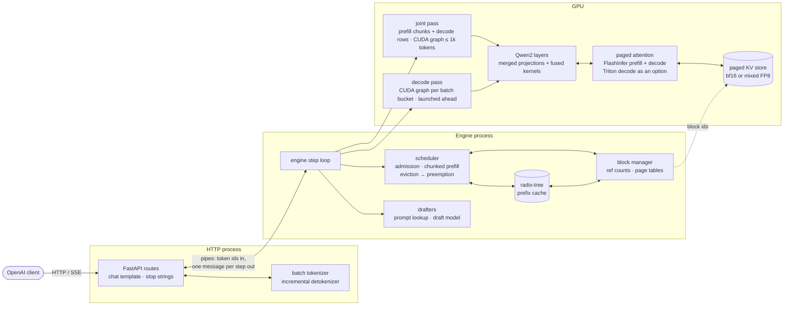
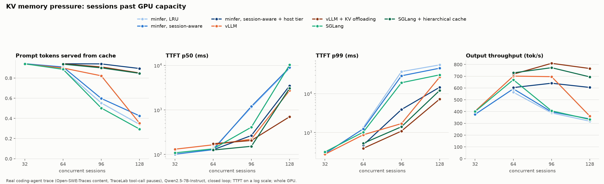
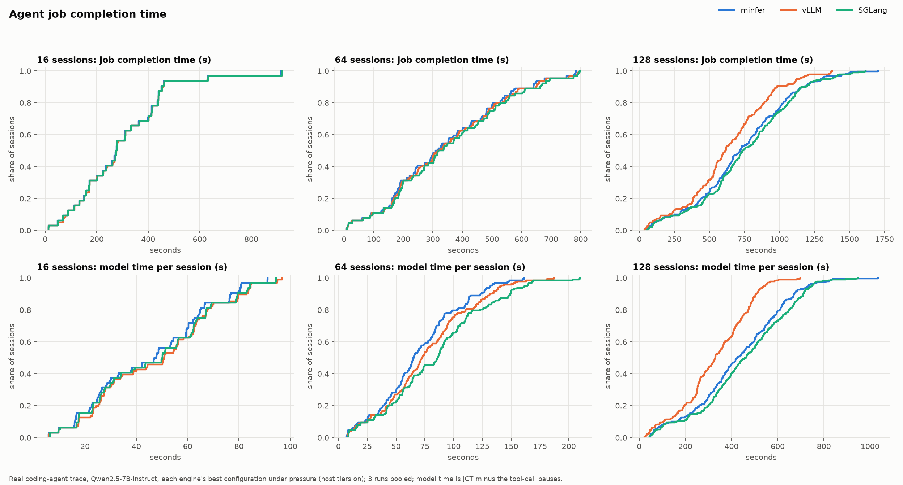
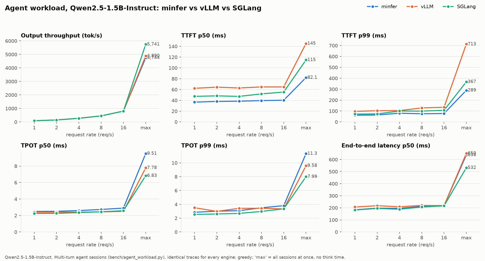
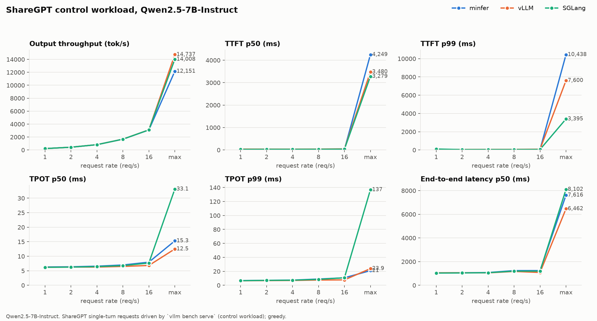
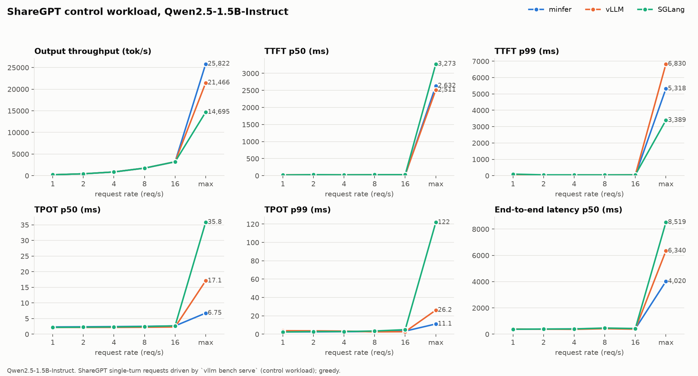
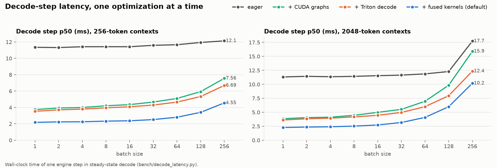

# minfer

**minfer is a from-scratch LLM inference engine, used here as a controlled testbed: it
measures, on real coding-agent traces, what each agent-serving technique contributes alone
and in combination.** Agents resend almost everything they have already sent — the same
system prompt and tool schemas on every request, the whole conversation on every turn —
and between turns they wait for tools while their history sits in GPU memory. The
techniques that exploit this have each been published by others
([related work](#related-work-and-what-is-and-is-not-new-here)); none is new here. What
this repository adds is all of them in one engine where each is a flag — a radix-tree
prefix cache over paged KV, session-aware retention, a host-memory KV tier,
position-independent KV reuse, prompt-lookup speculative decoding — measured on the same
traces, next to vLLM and SGLang in their best configurations. The engine itself is a
pure-PyTorch implementation of Qwen2.5 with its own Triton kernels next to FlashInfer's,
continuous batching with CUDA-graph execution, and an OpenAI-compatible server; it is not
a wrapper around another serving engine.

> Phase-by-phase status with each acceptance result: [PROGRESS.md](PROGRESS.md).
> Every design decision, bug, root cause and measurement: [DESIGN.md](DESIGN.md).

## Headline result

**On real coding-agent traces at 7B, once concurrent sessions exceed GPU memory, one
technique decides the outcome — a host-memory tier for the KV cache — and vLLM with its own
offloading is the fastest system measured. minfer with every exact technique enabled
recomputes the least (31–41% fewer prefill tokens per call than either baseline past
capacity), is level with SGLang there, and is 4–9% behind vLLM in throughput.**

Each engine in its best measured configuration, 64–128 concurrent sessions (one H100 holds
the KV of about 55–65):

<!-- BEGIN full-stack -->
| concurrent sessions | metric | minfer: prefix cache + session-aware retention + host tier | vLLM + native KV offloading | SGLang + hierarchical cache |
|---|---|---|---|---|
| 64 | TTFT p50 (ms) | **117** | 174 | 126 |
|  | TTFT p99 (ms) | 449 | **392** | 528 |
|  | prefill tokens computed per call | **966** | 1,002 | 1,053 |
|  | TPOT p50 (ms) | 19.5 | **16.5** | 16.9 |
|  | output tok/s | 687 | 717 | **729** |
|  | calls completed in 240 s | 1,215 | **1,272** | 1,264 |
|  | failed requests | 0 | 0 | 0 |
| 96 | TTFT p50 (ms) | 159 | 206 | **153** |
|  | TTFT p99 (ms) | **570** | 1,091 | 1,409 |
|  | prefill tokens computed per call | **1,013** | 1,545 | 1,702 |
|  | TPOT p50 (ms) | 33.9 | **27.2** | 29.7 |
|  | output tok/s | 772 | **809** | 772 |
|  | calls completed in 240 s | 1,423 | **1,494** | 1,446 |
|  | failed requests | 0 | 0 | 0 |
| 128 | TTFT p50 (ms) | 2,811 | **704** | 3,071 |
|  | TTFT p99 (ms) | 10,983 | **7,278** | 12,147 |
|  | prefill tokens computed per call | **1,696** | 2,472 | 2,486 |
|  | TPOT p50 (ms) | 47.5 | **45.4** | 45.8 |
|  | output tok/s | 693 | **765** | 694 |
|  | calls completed in 240 s | 1,361 | **1,484** | 1,356 |
|  | failed requests | 0 | 0 | 0 |

Real coding-agent trace, Qwen2.5-7B-Instruct, one H100, 96 GB of host memory for each engine's KV tier. No approximate technique is in any of these configurations, so output quality is that of exact bf16 inference in all three.
<!-- END full-stack -->

Where minfer's numbers come from — every valid combination of the five techniques at 96
sessions ([`bench/composition.py`](bench/composition.py)), measured on the same engine
configuration as the table above:



<!-- BEGIN composition -->
| techniques | calls completed | prefill tokens computed per call | prompt tokens not computed | TTFT p50 / p99 (ms) | TPOT p50 (ms) | out tok/s |
|---|---|---|---|---|---|---|
| none | 537 | 13,428 | 0.0% | 20820 / 28444 | 70.5 | 242 |
| prefix cache | 835 | 7,083 | 55.8% | 634 / 34705 | 52.5 | 404 |
| prompt-lookup speculation | 423 | 12,634 | 0.0% | 32670 / 46279 | 85.2 | 171 |
| prefix cache + session-aware retention | 849 | 6,217 | 61.2% | 878 / 22946 | 53.4 | 427 |
| prefix cache + position-independent reuse | 829 | 6,674 | 58.3% | 778 / 31019 | 53.7 | 405 |
| prefix cache + prompt-lookup speculation | 573 | 5,500 | 61.4% | 1732 / 42780 | 132.6 | 260 |
| prefix cache + session-aware retention + host-memory tier | 1366 | 1,038 | 93.9% | 174 / 1252 | 38.3 | 758 |
| prefix cache + session-aware retention + position-independent reuse | 838 | 6,160 | 61.5% | 875 / 23373 | 63.1 | 414 |
| prefix cache + session-aware retention + prompt-lookup speculation | 599 | 4,982 | 65.2% | 2536 / 33321 | 133.4 | 279 |
| prefix cache + position-independent reuse + prompt-lookup speculation | 567 | 5,401 | 61.9% | 1495 / 43232 | 134.5 | 260 |
| prefix cache + session-aware retention + host-memory tier + position-independent reuse | 1343 | 975 | 94.2% | 189 / 1726 | 38.4 | 740 |
| prefix cache + session-aware retention + host-memory tier + prompt-lookup speculation | 702 | 1,030 | 93.0% | 546 / 10185 | 131.2 | 351 |
| prefix cache + session-aware retention + position-independent reuse + prompt-lookup speculation | 587 | 4,877 | 66.0% | 2066 / 33427 | 135.8 | 284 |
| prefix cache + session-aware retention + host-memory tier + position-independent reuse + prompt-lookup speculation | 700 | 976 | 93.4% | 634 / 11105 | 131.0 | 353 |

96 concurrent sessions of the real trace, 240 s measured after 120 s of warm-up, whole GPU.
<!-- END composition -->

What the composition shows:

- **The prefix cache is necessary and far from sufficient under pressure.** Without it a
  call prefills 13k tokens and median time-to-first-token is 21 s. With it, at 96 sessions
  the cache thrashes: 56% of prompt tokens are served from cache where an unlimited cache
  would serve 94%.
- **The host-memory tier is the technique that matters**: prefill per call falls from
  6,217 to 1,038 tokens (the 94% ceiling), throughput rises 1.8×, median TTFT falls 5×.
  Copying a session's KV back from host memory is 18–29× cheaper than recomputing it.
- **Session-aware retention is a small gain** (12% fewer prefill tokens than LRU, a lower
  TTFT tail) that does not prevent the collapse by itself; the host tier needs its
  eviction order, so the two are measured together.
- **Position-independent reuse is nearly irrelevant on this trace**: 1–6% fewer prefill
  tokens, with or without the host tier, and no gain in latency or throughput beyond
  run-to-run noise, because only 0.8% of the trace's tokens are shifted
  duplicates — and it costs output fidelity (about 3% of next-token predictions change).
- **Prompt-lookup speculation hurts at this load**: with the prefix cache on it
  raises per-token latency 2.2–3.4× and it costs 29–54% of throughput in every combination.
  It lowers per-token latency by 8–15% on a
  lightly loaded server ([below](#component-measurements)); a saturated one has no spare
  rows to verify drafts with.
- **Interactions.** Nothing compounds. The prefill savings of retention, the host tier and
  reuse overlap (each recovers part of the same evicted history, and once the host tier
  has brought the hit rate to its ceiling there is little left for the others), and
  speculation competes with all of them for compute: with the host tier it takes back
  most of the throughput the tier gained (758 → 351 tok/s). The best valid combination for
  this workload is therefore the three exact KV techniques and nothing else.

<!-- BEGIN interactions -->
| pair (on top of what both need) | metric | without either | first alone | second alone | both | both − sum of each |
|---|---|---|---|---|---|---|
| session-aware retention × position-independent reuse | prefill tokens / call | 7,083 | -867 | -410 | -924 | +353 |
| session-aware retention × position-independent reuse | TTFT p50 (ms) | 634 | +244 | +144 | +241 | -147 |
| session-aware retention × position-independent reuse | TPOT p50 (ms) | 52.50 | +0.94 | +1.16 | +10.63 | +8.53 |
| session-aware retention × prompt-lookup speculation | prefill tokens / call | 7,083 | -867 | -1,583 | -2,102 | +348 |
| session-aware retention × prompt-lookup speculation | TTFT p50 (ms) | 634 | +244 | +1098 | +1902 | +560 |
| session-aware retention × prompt-lookup speculation | TPOT p50 (ms) | 52.50 | +0.94 | +80.06 | +80.89 | -0.11 |
| position-independent reuse × prompt-lookup speculation | prefill tokens / call | 7,083 | -410 | -1,583 | -1,682 | +311 |
| position-independent reuse × prompt-lookup speculation | TTFT p50 (ms) | 634 | +144 | +1098 | +861 | -381 |
| position-independent reuse × prompt-lookup speculation | TPOT p50 (ms) | 52.50 | +1.16 | +80.06 | +81.98 | +0.77 |
| host-memory tier × position-independent reuse | prefill tokens / call | 6,217 | -5,179 | -57 | -5,241 | -6 |
| host-memory tier × position-independent reuse | TTFT p50 (ms) | 878 | -703 | -3 | -689 | +18 |
| host-memory tier × position-independent reuse | TPOT p50 (ms) | 53.45 | -15.11 | +9.69 | -15.04 | -9.62 |
| host-memory tier × prompt-lookup speculation | prefill tokens / call | 6,217 | -5,179 | -1,235 | -5,186 | +1,227 |
| host-memory tier × prompt-lookup speculation | TTFT p50 (ms) | 878 | -703 | +1658 | -332 | -1286 |
| host-memory tier × prompt-lookup speculation | TPOT p50 (ms) | 53.45 | -15.11 | +79.95 | +77.77 | +12.93 |
<!-- END interactions -->

Single runs. Three configurations were measured twice (in this table and in the
[pressure sweep](#real-coding-agent-traces-under-memory-pressure)): throughput repeated to
within 2% and hit rate to within a point, but latency percentiles did not: median TTFT
moved by up to 12% between the two runs, and the full stack's TTFT p99 at 96 sessions was
1,252 ms here and 570 ms in the sweep (1,270 ms in an earlier run of the same
configuration). Per-call figures in collapsing configurations also depend on which calls
complete. Differences of that size in this table, and minfer's TTFT p99 at 96 sessions in
the table at the top, are not findings.

**Why minfer is behind vLLM with everything on.** Not KV management — it recomputes
31–41% fewer prefill tokens than either baseline at 96 and 128 sessions — but its decode
path: per-token latency is 1.18× vLLM's at 64 sessions, where both are at the hit-rate
ceiling ([details](#where-minfer-loses-to-vllm-and-sglang-and-why)).

## Engine comparison on a synthetic agent workload

The same three engines on a generated agent workload that fits in GPU memory
(`bench/agent_workload.py`), where the differences are in the engines' request paths
rather than in KV management.

<!-- BEGIN headline -->
On the multi-turn agent workload at 1–16 req/s (Qwen2.5-7B-Instruct, bf16, one H100, greedy, identical traces):

| | minfer | vLLM | SGLang |
|---|---|---|---|
| TTFT p50 (ms) | 48–57 | 76–83 | 57–67 |
| TTFT p99 (ms) | 88–112 | 122–143 | 101–132 |
| TPOT p50 (ms) | 6.14–7.59 | 6.28–7.78 | 6.27–8.25 |
| prefix-cache hit rate | 93.0%–93.6% | 92.6%–93.2% | 93.1%–93.7% |
| saturated output tok/s ("max") | 2224 | 2255 | 2230 |
| TTFT p50 relative to vLLM | 0.62–0.73× | 1.00× | 0.75–0.82× |
| TPOT p50 relative to vLLM | 0.97–1.00× | 1.00× | 1.00–1.06× |
| saturated tok/s relative to vLLM | 0.99× | 1.00× | 0.99× |
| saturated TTFT p50 / p99 (ms) | 108 / 279 | 165 / 753 | 151 / 324 |
<!-- END headline -->

The same comparison on the model the engine was developed on (Qwen2.5-1.5B; re-measured
on the final code, baselines with the flags the [fairness audit](#fairness-audit)
selected):

<!-- BEGIN headline-1.5b -->
On the multi-turn agent workload at 1–16 req/s (Qwen2.5-1.5B-Instruct, bf16, one H100, greedy, identical traces):

| | minfer | vLLM | SGLang |
|---|---|---|---|
| TTFT p50 (ms) | 37–40 | 62–65 | 47–55 |
| TTFT p99 (ms) | 62–80 | 97–134 | 72–106 |
| TPOT p50 (ms) | 2.49–2.89 | 2.41–2.50 | 2.25–2.59 |
| prefix-cache hit rate | 93.0%–93.6% | 92.6%–93.2% | 93.1%–93.7% |
| saturated output tok/s ("max") | 4744 | 4890 | 5741 |
| TTFT p50 relative to vLLM | 0.59–0.62× | 1.00× | 0.75–0.85× |
| TPOT p50 relative to vLLM | 1.04–1.16× | 1.00× | 0.94–1.04× |
| saturated tok/s relative to vLLM | 0.97× | 1.00× | 1.17× |
| saturated TTFT p50 / p99 (ms) | 82 / 289 | 145 / 713 | 115 / 367 |
<!-- END headline-1.5b -->

**minfer answers first.** At 7B it has the lowest median time-to-first-token of the three
engines at every request rate on the agent workload and when saturated (21–29 ms ahead of
vLLM, 7–10 ms ahead of SGLang at 1–16 req/s), and the lowest 99th percentile.
All three engines reuse the same share of prompt tokens (hit-rate row) — on this workload
their prefix caches are equally effective — so the lead is not a better hit rate; it is a
shorter path from socket to first token for a request that is mostly cache hits. A
[fairness audit](#fairness-audit), run at 1.5B, took that path apart: when clients send
token ids instead of text, minfer's lead over vLLM is unchanged (16 vs 36 ms) but its lead
over SGLang shrinks from about 10 ms to about 3 ms, and disappears at the median when
saturated. Against SGLang, most of the lead is therefore the HTTP front end (batched
tokenization off the event loop), not the engine; against vLLM it is the engine path
(block-sharing admission with no copy, and a CUDA-graph prefill pass for the few hundred
tokens that are actually new).

**Per-token latency is now level with vLLM's below saturation.** At 1–16 req/s minfer's
TPOT p50 is 0.97–1.00× of vLLM's and 0.92–0.98× of SGLang's; saturated throughput is
0.99× of either. Until Phase 18 it was 1.06–1.14× of vLLM (0.91× saturated): a decode step
ended by reading its tokens back before the next could be planned, and a step with prefill
work made two passes over the weights. Two changes closed it, each measured on its own
([decode gap](#closing-the-decode-gap)): decode steps launched before the previous step's
tokens are read (`--async-decode`), and joint passes in which prefill chunks and decoding
sequences share one pass over the weights, each group on its own attention kernel
(`--unified-batches`). Saturated, vLLM is still ahead per token (TPOT p50 20.0 vs 22.3 ms);
see [where minfer loses](#where-minfer-loses-to-vllm-and-sglang-and-why).

## Architecture



How a request flows:

1. The HTTP process applies the chat template, tokenizes (batched, off the event loop) and
   sends token ids to the engine process over a pipe.
2. The scheduler looks the prompt up in the radix tree. Blocks for the longest cached
   prefix are *shared* into the request's page table (a reference count, no copy); only the
   remaining tokens are prefilled, in chunks interleaved with other requests' decode steps.
3. Each engine step is one pass over the weights: a joint pass when it has prefill work
   (the prefill chunks through FlashInfer's prefill kernel, the decoding sequences through
   its decode kernel), a decode pass otherwise, both replayed from CUDA graphs when their
   shape fits a bucket. Consecutive decode steps are pipelined: the next is launched
   before the current one's tokens are read back. Blocks are published to
   the radix tree as soon as they are full, so a second request with the same prefix can
   hit while the first is still running.
4. Under memory pressure the cache gives back least-recently-used leaves before any
   running request is preempted; preempted requests are recomputed later (usually from the
   cache).
5. Tokens stream back one message per engine step and are detokenized incrementally into
   SSE chunks.

| Component | Where | Notes |
|---|---|---|
| Qwen2 forward pass, safetensors loading | `minfer/model/` | verified against `transformers` (fp32 max abs logit diff 8e-5); fused path in `fused.py` |
| Block manager, paged KV store | `minfer/cache/` | 16-token blocks, ref counts, O(1) evictable count, optional mixed-precision FP8 |
| Radix-tree prefix cache | `minfer/cache/radix_tree.py` | block-aligned edges, split on divergence, leaf eviction by LRU or by expected time to next use; content index for position-independent reuse |
| Session-aware retention | `minfer/cache/retention.py` | per-tool pause model learned online; eviction order by expected remaining pause |
| Host-memory KV tier | `minfer/cache/host_tier.py` | pinned block-major pool, asynchronous offload and restore on a side CUDA stream |
| Scheduler | `minfer/scheduler/` | cache-aware admission with starvation guard, chunked prefill, preemption by recompute |
| Attention | `minfer/attention/` | FlashInfer prefill and decode kernels, a Triton paged decode kernel as an option, CUDA graphs for decode, prefill and speculative verification |
| Speculative decoding | `minfer/spec/` | prompt-lookup and draft-model drafters; exact for greedy, unbiased for sampling |
| Tensor parallelism | `minfer/parallel/` | Megatron-style shards, head-sharded KV cache (CPU-verified only) |
| FP8 | `minfer/quant/` | E4M3 weights + activations; E4M3 KV cache with calibrated scales |
| Server | `minfer/server/` | OpenAI-compatible; engine in its own process |
| Benchmarks | `bench/` | synthetic agent workload and real-trace replay, three-engine matrix, pressure sweep, composition study, ablations, plots |

## Real coding-agent traces under memory pressure

The comparison above uses a synthetic agent workload that fits in GPU memory. This section
uses real trajectories, and asks what happens when the sessions' KV does not fit.

**The trace** ([`bench/real_traces.py`](bench/real_traces.py)). No public dataset has both
the content and the timing of real agent sessions, so two are combined: token sequences and
turn structure from `nvidia/Open-SWE-Traces` (Claude Code harness: full system prompt, tool
definitions, every assistant message and tool result), and tool-call pause durations
sampled per tool name from the 141,824 real tool-call timings of TraceLab. Sessions are cut
at Qwen2.5's 32k-token context.

<!-- BEGIN real-trace -->
| real trace (Qwen2.5-7B tokenizer) | value |
|---|---|
| sessions (cut at the 32k-token context limit) | 300 (163) |
| model calls | 8,112 |
| model calls per session, p50 / p90 / max | 28 / 42 / 57 |
| prompt tokens per call, p50 / p90 / max | 17,806 / 28,482 / 31,938 |
| tokens appended per call, p50 / p90 / max | 549 / 1,916 / 26,443 |
| output tokens per call, p50 / p90 / max | 100 / 451 / 7,179 |
| tool calls | Bash 7,404, Read 1,407, Edit 1,259 |
| pause after a call (s), p50 / p75 / p90 / p99 | 0.26 / 3.5 / 30 / 120 |
| pauses longer than 1 s / 10 s / 30 s | 40% / 16% / 10% |
| prefix / shifted duplicate / novel — all prompt tokens | 94.4% / 0.8% / 4.8% |
| prefix / shifted duplicate / novel — first call of a session | 6.3% / 66.8% / 26.9% |
| prefix / shifted duplicate / novel — later calls | 94.7% / 0.6% / 4.7% |
<!-- END real-trace -->

A token is *prefix* if an exact-prefix cache of unlimited size could serve it, *shifted
duplicate* if it is not but repeats, at another position, 32 tokens seen before (what
position-independent caching could add), *novel* otherwise. Two things follow before any
engine runs: prefix caching already covers 94% of the tokens if nothing is evicted, and
position-independent reuse has 0.8% of them to find, nearly all in the system prompt of a
session's first call (Claude Code's system prompt starts with the working directory, the
date and a git status, so sessions share it only *after* a different first paragraph).

**Memory pressure** ([`bench/pressure.py`](bench/pressure.py)). The trace replayed
closed-loop at 32–128 concurrent sessions; at 7B one H100 holds the KV of about 55–65
sessions. minfer is run with LRU eviction, with session-aware retention (the eviction
order follows the expected remaining tool-call pause of each session — the idea of
Continuum and CacheWise), and with a 96 GB host-memory tier on top (a session's KV is
copied to pinned memory when it pauses and copied back when it returns); vLLM and SGLang
are run with and without the CPU-memory KV offloading each ships (96 GB each).

<!-- BEGIN pressure -->
| concurrent sessions | configuration | calls completed | cache hit rate | prefill tokens computed per call | TTFT p50 / p99 (ms) | TPOT p50 (ms) | out tok/s | failed |
|---|---|---|---|---|---|---|---|---|
| 32 | minfer, session-aware retention | 642 | 94.0% | 986 | 100 / 410 | 9.7 | 382 | 0 |
|  | vLLM | 654 | 93.9% | 1,005 | 131 / 277 | 8.6 | 403 | 0 |
|  | SGLang | 653 | 94.1% | 972 | 109 / 317 | 8.9 | 400 | 0 |
| 64 | minfer, LRU eviction | 1139 | 88.5% | 1,899 | 126 / 1240 | 21.4 | 625 | 0 |
|  | minfer, session-aware retention | 1179 | 91.0% | 1,491 | 121 / 1207 | 20.2 | 655 | 0 |
|  | minfer, session-aware retention + 96 GB host tier | 1215 | 94.2% | 966 | 117 / 449 | 19.5 | 687 | 0 |
|  | vLLM | 1238 | 89.9% | 1,695 | 165 / 875 | 17.6 | 701 | 0 |
|  | vLLM + native KV offloading (96 GB) | 1272 | 94.1% | 1,002 | 174 / 392 | 16.5 | 717 | 0 |
|  | SGLang | 1202 | 88.7% | 1,891 | 134 / 1025 | 18.5 | 670 | 0 |
|  | SGLang + hierarchical cache (96 GB host) | 1264 | 93.8% | 1,053 | 126 / 528 | 16.9 | 729 | 0 |
| 96 | minfer, LRU eviction | 838 | 56.6% | 6,958 | 624 / 33852 | 50.5 | 406 | 0 |
|  | minfer, session-aware retention | 846 | 60.4% | 6,332 | 985 / 24202 | 57.1 | 424 | 0 |
|  | minfer, session-aware retention + 96 GB host tier | 1423 | 94.1% | 1,013 | 159 / 570 | 33.9 | 772 | 0 |
|  | vLLM | 1302 | 82.2% | 3,012 | 221 / 1703 | 38.3 | 696 | 0 |
|  | vLLM + native KV offloading (96 GB) | 1494 | 91.0% | 1,545 | 206 / 1091 | 27.2 | 809 | 0 |
|  | SGLang | 824 | 50.2% | 8,024 | 410 / 19150 | 42.9 | 406 | 0 |
|  | SGLang + hierarchical cache (96 GB host) | 1446 | 90.1% | 1,702 | 153 / 1409 | 29.7 | 772 | 0 |
| 128 | minfer, LRU eviction | 764 | 34.7% | 9,638 | 13163 / 55075 | 73.6 | 347 | 0 |
|  | minfer, session-aware retention | 806 | 44.8% | 8,253 | 12516 / 41633 | 77.2 | 393 | 0 |
|  | minfer, session-aware retention + 96 GB host tier | 1361 | 89.5% | 1,696 | 2811 / 10983 | 47.5 | 693 | 0 |
|  | vLLM | 791 | 35.2% | 9,877 | 2736 / 26787 | 138.8 | 362 | 0 |
|  | vLLM + native KV offloading (96 GB) | 1484 | 85.0% | 2,472 | 704 / 7278 | 45.4 | 765 | 0 |
|  | SGLang | 743 | 29.4% | 10,572 | 10280 / 30487 | 135.5 | 333 | 0 |
|  | SGLang + hierarchical cache (96 GB host) | 1356 | 84.7% | 2,486 | 3071 / 12147 | 45.8 | 694 | 0 |
<!-- END pressure -->



What the sweep shows:

- **Below capacity (32 sessions) nothing differs**: all three engines sit at the 94%
  ceiling.
- **Without a host tier every engine falls off a cliff** once live KV exceeds GPU memory:
  at 128 sessions the hit rate is 29–45%, engines prefill 8–11k tokens per call instead of
  1k, and median time-to-first-token is 3–13 seconds.
- **Session-aware retention alone is a small, consistent gain** over LRU in the same engine
  (+2.5 to +10 points of hit rate, 9–21% fewer prefill tokens, 3–29% lower TTFT p99) and
  **does not prevent the collapse**. When the live sessions do not fit, which one is
  evicted matters little: half of this trace's pauses are under 0.3 s, so every victim is
  about to return.
- **A host-memory tier is what decides this workload, for every engine.** With one, all
  three are back at the ceiling at 64 sessions, at 90–94% at 96 and at 85–90% at 128.
  Copying a 30,000-token history back from host memory takes 32 ms on this machine;
  recomputing it takes 928 ms:

<!-- BEGIN host-tier-cost -->
| history (tokens) | KV (MB) | restore from host (ms) | GB/s | recompute (ms) | recompute / restore |
|---|---|---|---|---|---|
| 1,024 | 56 | 1.2 | 44 | 23 | 18× |
| 4,096 | 224 | 4.8 | 45 | 93 | 19× |
| 8,192 | 448 | 9.1 | 48 | 193 | 21× |
| 16,384 | 896 | 17.8 | 49 | 423 | 24× |
| 30,000 | 1,641 | 31.8 | 50 | 928 | 29× |
<!-- END host-tier-cost -->

- **With a host tier, vLLM is the fastest system here and minfer the one that recomputes
  least.** At 96 and 128 sessions minfer computes a third or more fewer prefill tokens per
  call than vLLM or SGLang with their offloading (it offloads at every pause and demotes
  by expected return). It still delivers 0.96× / 0.95× / 0.91× of vLLM's throughput at
  64 / 96 / 128 sessions, and is level with SGLang at 96 and 128. What remains is the decode path described
  [below](#where-minfer-loses-to-vllm-and-sglang-and-why): on this trace every engine step
  has prefill work, which is where minfer's two passes per step cost most (per-token
  latency 1.18× vLLM's at 64 sessions, where both are at the hit-rate ceiling).

**Agent job completion time** ([`bench/jct.py`](bench/jct.py), DESIGN.md D-045). What an
agent waits for is its whole job: every model call of a session plus the tool calls in
between. The same trace and replay, each engine in its best configuration under pressure;
at concurrency `C` the `C` sessions that start the load are not measured, the next 32 / 64
/ 96 are, and the load continues until every measured session has finished.

<!-- BEGIN jct -->
_Not measured yet._
<!-- END jct -->



## Results

All numbers below are generated from the JSON files in [`bench/results/`](bench/results) by
[`bench/readme_tables.py`](bench/readme_tables.py); none is typed by hand
(`python -m bench.readme_tables --check` fails if this file is stale). Hardware and
software versions are in [`bench/ENV.md`](bench/ENV.md): one H100 80GB, vLLM 0.34.0,
SGLang 0.5.23, PyTorch 2.14, FlashInfer 0.7.3.

### Agent workload: minfer vs vLLM vs SGLang

**Qwen2.5-7B-Instruct** (baselines with the flags the fairness audit selected):

<!-- BEGIN agent-results -->
| rate (req/s) | engine | out tok/s | TTFT p50 (ms) | TTFT p99 (ms) | TPOT p50 (ms) | TPOT p99 (ms) | E2E p50 (ms) | E2E p99 (ms) | prefix hit rate | failed |
|---|---|---|---|---|---|---|---|---|---|---|
| 1 | minfer | 89 | **47.8** | **90.0** | **6.14** | **6.87** | **418** | **1377** | 93.6% | 0 |
|  | vLLM | 88 | 76.8 | 122.2 | 6.28 | 7.16 | 450 | 1450 | 93.2% | 0 |
|  | SGLang | 89 | 57.4 | 100.8 | 6.27 | 7.32 | 429 | 1404 | **93.7%** | 0 |
| 2 | minfer | 144 | **52.3** | **87.8** | **6.23** | 7.04 | **443** | **1433** | 93.1% | 0 |
|  | vLLM | 143 | 79.7 | 124.2 | 6.40 | **7.00** | 477 | 1513 | 92.8% | 0 |
|  | SGLang | 144 | 60.2 | 101.2 | 6.41 | 7.15 | 462 | 1483 | **93.2%** | 0 |
| 4 | minfer | **258** | **52.3** | **95.5** | **6.55** | 7.90 | **455** | **1251** | 93.1% | 0 |
|  | vLLM | 257 | 76.0 | 129.0 | 6.59 | **7.53** | 479 | 1323 | 92.7% | 0 |
|  | SGLang | 257 | 62.5 | 110.4 | 6.83 | 8.06 | 477 | 1340 | **93.2%** | 0 |
| 8 | minfer | **420** | **57.0** | **100.4** | **6.87** | **8.65** | **480** | **1504** | 93.0% | 0 |
|  | vLLM | 418 | 78.0 | 142.1 | 6.92 | 8.69 | 505 | 1546 | 92.6% | 0 |
|  | SGLang | 417 | 63.7 | 131.6 | 7.21 | 9.42 | 510 | 1589 | **93.1%** | 0 |
| 16 | minfer | **754** | **57.1** | **111.6** | **7.59** | 11.20 | **513** | **1698** | 93.2% | 0 |
|  | vLLM | 748 | 82.9 | 143.2 | 7.78 | **10.08** | 548 | 1785 | 92.8% | 0 |
|  | SGLang | 748 | 67.1 | 132.3 | 8.25 | 11.18 | 559 | 1871 | **93.3%** | 0 |
| max | minfer | 2224 | **107.9** | **279.3** | 22.28 | 26.31 | 1403 | 4343 | 92.8% | 0 |
|  | vLLM | **2255** | 165.3 | 753.1 | **19.98** | **24.41** | **1375** | **4008** | 92.5% | 0 |
|  | SGLang | 2230 | 151.2 | 323.8 | 21.28 | 25.93 | 1403 | 4188 | **92.9%** | 0 |
<!-- END agent-results -->


**Qwen2.5-1.5B-Instruct:**

Multi-turn agent sessions ([`bench/agent_workload.py`](bench/agent_workload.py): three
agent types, ~4k-token system prompts with JSON tool schemas, 5–15 turns, tool results
appended every turn; prompts of 4k–14k tokens, outputs of 33–240 tokens), replayed from
identical traces against each server. Greedy decoding, same model and dtype
(Qwen2.5-1.5B-Instruct, bf16), one server at a time, prefix caching on in all three; the
baselines run with the flags the [fairness audit](#fairness-audit) selected. Rate is the nominal request rate; "max" starts 64 sessions at once with
no think time. A value is bold when it is the best of the three at the printed precision.

<!-- BEGIN agent-results-1.5b -->
| rate (req/s) | engine | out tok/s | TTFT p50 (ms) | TTFT p99 (ms) | TPOT p50 (ms) | TPOT p99 (ms) | E2E p50 (ms) | E2E p99 (ms) | prefix hit rate | failed |
|---|---|---|---|---|---|---|---|---|---|---|
| 1 | minfer | 89 | **36.7** | **61.8** | 2.49 | 2.85 | 183 | 587 | 93.6% | 0 |
|  | vLLM | 89 | 62.2 | 97.0 | 2.41 | 3.50 | 206 | 589 | 93.2% | 0 |
|  | SGLang | 89 | 47.3 | 72.0 | **2.25** | **2.53** | **182** | **551** | **93.7%** | 0 |
| 2 | minfer | 146 | **37.9** | **63.5** | 2.51 | 3.00 | 197 | 628 | 93.1% | 0 |
|  | vLLM | 146 | 64.4 | 102.7 | 2.41 | 2.98 | 218 | 604 | 92.8% | 0 |
|  | SGLang | 146 | 48.3 | 73.4 | **2.26** | **2.60** | **195** | **574** | **93.2%** | 0 |
| 4 | minfer | 270 | **38.4** | **80.0** | 2.60 | 3.08 | 195 | 540 | 93.1% | 0 |
|  | vLLM | 269 | 62.8 | 103.9 | 2.41 | 3.42 | 209 | 527 | 92.7% | 0 |
|  | SGLang | 270 | 47.3 | 100.0 | **2.35** | **2.69** | **188** | **503** | **93.2%** | 0 |
| 8 | minfer | 446 | **39.5** | **74.8** | 2.73 | 3.49 | 212 | 619 | 93.0% | 0 |
|  | vLLM | 446 | 64.8 | 128.3 | **2.44** | 3.42 | 220 | 598 | 92.6% | 0 |
|  | SGLang | **447** | 51.9 | 99.4 | 2.45 | **2.96** | **206** | **566** | **93.1%** | 0 |
| 16 | minfer | 800 | **40.2** | **77.2** | 2.89 | 3.80 | 217 | 677 | 93.2% | 0 |
|  | vLLM | 801 | 64.8 | 134.3 | **2.50** | **3.34** | 218 | 629 | 92.8% | 0 |
|  | SGLang | 801 | 55.3 | 106.4 | 2.59 | 3.35 | **216** | **625** | **93.3%** | 0 |
| max | minfer | 4744 | **82.1** | **289.4** | 9.51 | 11.33 | 638 | 2002 | 92.8% | 0 |
|  | vLLM | 4890 | 145.2 | 712.6 | 7.78 | 9.58 | 650 | 1808 | 92.5% | 0 |
|  | SGLang | **5741** | 114.7 | 367.4 | **6.83** | **7.99** | **532** | **1498** | **92.9%** | 0 |
<!-- END agent-results-1.5b -->



### ShareGPT (control workload)

**Qwen2.5-7B-Instruct:**

<!-- BEGIN sharegpt-results -->
| rate (req/s) | engine | out tok/s | TTFT p50 (ms) | TTFT p99 (ms) | TPOT p50 (ms) | TPOT p99 (ms) | E2E p50 (ms) | E2E p99 (ms) | failed |
|---|---|---|---|---|---|---|---|---|---|
| 1 | minfer | 214 | **22.3** | **47.5** | **5.97** | **6.16** | **995** | **4631** | 0 |
|  | vLLM | 214 | 38.1 | 65.3 | 6.08 | 6.49 | 1031 | 4766 | 0 |
|  | SGLang | 214 | 27.0 | 420.8 | 6.18 | 6.50 | 1033 | 4906 | 0 |
| 2 | minfer | 424 | **21.7** | **28.0** | **6.00** | **6.26** | **999** | **4626** | 0 |
|  | vLLM | 424 | 37.9 | 55.3 | 6.15 | 6.40 | 1035 | 4826 | 0 |
|  | SGLang | 424 | 32.9 | 88.1 | 6.28 | 7.25 | 1042 | 4932 | 0 |
| 4 | minfer | **821** | **23.1** | **42.6** | **6.10** | **6.59** | **1006** | **4701** | 0 |
|  | vLLM | 819 | 40.4 | 70.1 | 6.29 | 7.00 | 1060 | 4947 | 0 |
|  | SGLang | 818 | 31.8 | 48.6 | 6.46 | 7.24 | 1070 | 5064 | 0 |
| 8 | minfer | **1672** | **23.1** | **45.9** | **6.27** | **7.56** | **1114** | **4821** | 0 |
|  | vLLM | 1668 | 42.5 | 68.6 | 6.52 | 7.61 | 1178 | 5078 | 0 |
|  | SGLang | 1667 | 33.1 | 53.6 | 6.86 | 8.54 | 1224 | 5391 | 0 |
| 16 | minfer | **3110** | **24.5** | **48.3** | **6.63** | 8.44 | **1034** | **5216** | 0 |
|  | vLLM | 3105 | 50.6 | 88.4 | 6.86 | **7.52** | 1096 | 5409 | 0 |
|  | SGLang | 3098 | 35.9 | 62.5 | 7.74 | 11.92 | 1216 | 6077 | 0 |
| max | minfer | 14016 | 4031.7 | 9106.5 | **12.49** | **18.20** | **6619** | 13466 | 0 |
|  | vLLM | **15532** | **3046.8** | 5982.2 | 19.92 | 33.89 | 6911 | **12127** | 0 |
|  | SGLang | 11920 | 3305.6 | **4948.6** | 52.27 | 629.59 | 11007 | 16867 | 0 |
<!-- END sharegpt-results -->



**Qwen2.5-1.5B-Instruct:**

Single-turn chat requests with little shared prefix, driven by vLLM's own benchmark client
(`vllm bench serve`). This workload does not play to minfer's design; it shows what the
engine does when there is nothing to reuse, measured by a client this repository did not
write.

<!-- BEGIN sharegpt-results-1.5b -->
| rate (req/s) | engine | out tok/s | TTFT p50 (ms) | TTFT p99 (ms) | TPOT p50 (ms) | TPOT p99 (ms) | E2E p50 (ms) | E2E p99 (ms) | failed |
|---|---|---|---|---|---|---|---|---|---|
| 1 | minfer | 215 | **10.6** | **19.3** | 2.31 | 2.48 | 383 | 1794 | 0 |
|  | vLLM | 215 | 25.0 | 46.3 | **2.17** | 3.77 | 393 | **1704** | 0 |
|  | SGLang | 215 | 21.1 | 95.1 | 2.18 | **2.36** | **375** | 1734 | 0 |
| 2 | minfer | 429 | **10.1** | **14.8** | 2.36 | **2.50** | 386 | 1840 | 0 |
|  | vLLM | 428 | 25.4 | 40.1 | **2.16** | 3.65 | **380** | **1718** | 0 |
|  | SGLang | 429 | 29.0 | 50.5 | 2.24 | 2.84 | 393 | 1857 | 0 |
| 4 | minfer | 856 | **10.6** | **17.9** | 2.42 | **2.70** | 396 | 1893 | 0 |
|  | vLLM | 857 | 24.3 | 45.6 | **2.17** | 3.36 | **368** | **1736** | 0 |
|  | SGLang | 857 | 24.9 | 47.8 | 2.32 | 2.86 | 399 | 1849 | 0 |
| 8 | minfer | 1739 | **10.9** | **16.0** | 2.51 | 2.80 | 444 | 1952 | 0 |
|  | vLLM | 1740 | 26.5 | 45.7 | **2.21** | **2.53** | **416** | **1757** | 0 |
|  | SGLang | 1740 | 27.4 | 46.7 | 2.43 | 3.44 | 467 | 1975 | 0 |
| 16 | minfer | 3208 | **12.1** | **20.0** | 2.65 | 3.34 | 414 | 2068 | 0 |
|  | vLLM | **3211** | 28.7 | 51.1 | **2.30** | **2.66** | **381** | **1844** | 0 |
|  | SGLang | 3209 | 29.2 | 50.1 | 2.66 | 4.91 | 430 | 2217 | 0 |
| max | minfer | **25822** | 2632.4 | 5318.4 | **6.75** | **11.11** | **4020** | **7356** | 0 |
|  | vLLM | 21466 | **2511.4** | 6829.6 | 17.08 | 26.16 | 6340 | 9362 | 0 |
|  | SGLang | 14695 | 3273.3 | **3389.0** | 35.84 | 121.79 | 8519 | 13663 | 0 |
<!-- END sharegpt-results-1.5b -->



### Fairness audit

The first version of these tables ran every engine at its defaults. That is a rule a
reviewer can fairly object to, so the comparison was audited at 1.5B
([`bench/fairness_audit.py`](bench/fairness_audit.py); every setting of the three servers
is listed side by side in DESIGN.md D-038). Each baseline was measured with the flags its
documentation offers for a latency-sensitive, prefix-heavy workload, on the same traces,
and all three engines were measured once more with the prompts sent as token ids, which
takes server-side tokenization out of the path. The tables above already use what the
audit selected; this is the audit itself, as measured at the time.

<!-- BEGIN fairness-audit -->
| engine / configuration | flags added to the defaults | 4 req/s: TTFT p50 / p99 (ms) | 4 req/s: TPOT p50 / p99 (ms) | 16 req/s: TTFT p50 / p99 (ms) | 16 req/s: TPOT p50 / p99 (ms) | max: tok/s | max: TTFT p50 / p99 (ms) | max: TPOT p50 / p99 (ms) |
|---|---|---|---|---|---|---|---|---|
| minfer / default | — | 39 / 67 | 2.64 / 3.15 | 40 / 82 | 2.99 / 4.18 | 4211 | 84 / 258 | 10.99 / 12.74 |
| vLLM / default | — | 62 / 99 | 2.38 / 2.96 | 64 / 127 | 2.54 / 3.39 | 4987 | 157 / 644 | 7.61 / 9.75 |
| vLLM / no access log | `--disable-uvicorn-access-log` | 63 / 95 | 2.40 / 3.09 | 65 / 119 | 2.49 / 3.18 | 4937 | 158 / 727 | 7.47 / 9.22 |
| vLLM / xxhash | `--prefix-caching-hash-algo` `xxhash` | 58 / 101 | 2.38 / 3.00 | 66 / 130 | 2.54 / 3.39 | 4954 | 149 / 709 | 7.58 / 9.39 |
| vLLM / interactivity | `--performance-mode` `interactivity` | 61 / 99 | 2.39 / 3.22 | 65 / 124 | 2.46 / 3.35 | 4917 | 173 / 744 | 7.39 / 9.58 |
| vLLM / throughput | `--performance-mode` `throughput` | 63 / 103 | 2.40 / 3.42 | 66 / 126 | 2.55 / 3.40 | 4899 | 133 / 737 | 7.78 / 9.54 |
| SGLang / default | — | 49 / 95 | 2.32 / 3.03 | 50 / 114 | 2.60 / 3.48 | 5071 | 103 / 453 | 8.33 / 10.77 |
| SGLang / lpm | `--schedule-policy` `lpm` | 49 / 94 | 2.34 / 3.07 | 48 / 130 | 2.60 / 3.55 | 5021 | 122 / 465 | 8.11 / 10.60 |
| SGLang / batch tokenizer | `--enable-dynamic-batch-tokenizer` | 48 / 86 | 2.36 / 2.72 | 55 / 107 | 2.59 / 3.18 | 5796 | 116 / 402 | 6.83 / 8.27 |
| SGLang / mixed chunk | `--enable-mixed-chunk` | 49 / 95 | 2.33 / 3.05 | 48 / 122 | 2.48 / 3.43 | 5131 | 308 / 540 | 5.69 / 7.73 |
| SGLang / torch compile | `--enable-torch-compile` | 141 / 193 | 69.87 / 70.87 | 132 / 214 | 40.10 / 72.23 | 1225 | 120 / 472 | 9.00 / 70.78 |
| minfer / token ids | (prompts sent as token ids) | 16 / 34 | 2.65 / 3.23 | 17 / 32 | 2.98 / 4.28 | 4214 | 33 / 216 | 11.50 / 13.56 |
| vLLM / token ids | (prompts sent as token ids) | 36 / 68 | 2.39 / 3.14 | 36 / 87 | 2.52 / 3.26 | 5207 | 88 / 406 | 8.34 / 9.93 |
| SGLang / token ids | (prompts sent as token ids) | 19 / 30 | 2.35 / 2.77 | 20 / 35 | 2.60 / 3.33 | 5569 | 31 / 346 | 8.61 / 10.09 |
| vLLM / tuned | `--disable-uvicorn-access-log` | 62 / 100 | 2.40 / 3.03 | 64 / 126 | 2.56 / 3.55 | 4979 | 125 / 651 | 7.75 / 9.63 |
| SGLang / tuned | `--enable-dynamic-batch-tokenizer` | 48 / 83 | 2.36 / 2.72 | 53 / 105 | 2.61 / 3.28 | 5780 | 113 / 373 | 6.83 / 8.20 |
<!-- END fairness-audit -->

What the audit changed:

- **vLLM's defaults are already its best configuration here.** No flag moved its numbers
  beyond the spread of its own repeated runs. It was the only server writing an access-log
  line per request; that is now off, for parity, with no measurable effect.
- **SGLang gains 14% saturated throughput from its batch tokenizer**
  (`--enable-dynamic-batch-tokenizer`), which the first tables did not give it. With it
  SGLang is the fastest of the three at saturation at 1.5B and minfer's deficit there is
  0.73×, not the 0.83× first published. Every benchmark since runs SGLang with that flag. Its `torch.compile` mode,
  the other documented candidate, was several times slower on this workload.
- **minfer's TTFT lead survives against the tuned baselines** (39–40 ms vs 62–64 ms and
  48–53 ms at 4–16 req/s) **but it is not all engine.** With token-id prompts the three
  engines' TTFT is 16–17, 36 and 19–20 ms, and when saturated SGLang's median (31 ms) is
  level with minfer's (33 ms). About two thirds of the lead over SGLang on text prompts
  comes from how the front ends tokenize a 25 KB prompt; the lead over vLLM is in the
  engine path either way.
- **The Triton decode kernel's published speed-up over FlashInfer was against the wrong
  baseline**; see [Component measurements](#component-measurements).

### Closing the decode gap

Until Phase 18 minfer was 6–14% behind vLLM per output token at 7B. Profiling both
engines' decode step the same way (`bench/decode_compare.py`, DESIGN.md M-033) showed
where: on the GPU the two do the same work (cuBLAS GEMMs, FlashInfer's decode kernel), but
minfer's step ended by reading its tokens back and only then scheduled and planned the
next one, so the host work between passes — growing with the batch — left the GPU idle,
while vLLM schedules asynchronously. Two changes:

- **Async decode** (`--async-decode`, DESIGN.md D-044): when the step after a decode step
  is predictably a decode step of the same sequences, it is launched before the current
  step's tokens are read, fed by them on the device; every input is staged in pinned
  memory so nothing in the launch synchronizes. Greedy requests; outputs unchanged (test).
- **Joint passes** (`--unified-batches`, DESIGN.md M-034): a step with prefill and decode
  work runs one pass over the weights instead of two, the prefill chunks through the
  prefill kernel and the decoding sequences through the decode kernel, from CUDA graphs
  captured at bucketed shapes. (An earlier version that sent decode rows through the
  prefill kernel lost 28% at saturation and was off by default.)

One decode step, pure decode loop:

<!-- BEGIN decode-compare -->
| batch × context | minfer, synchronous (ms) | minfer, async decode (ms) | vLLM 0.34 (ms) | synchronous / vLLM | async / vLLM |
|---|---|---|---|---|---|
| 1 × 1k | 6.20 | 5.91 | 6.18 | 1.004× | **0.956×** |
| 8 × 1k | 6.52 | 6.20 | 6.43 | 1.013× | **0.964×** |
| 32 × 1k | 7.27 | 6.79 | 6.96 | 1.045× | **0.975×** |
| 64 × 1k | 8.43 | 7.75 | 7.95 | 1.060× | **0.975×** |
| 128 × 1k | 10.82 | 9.72 | 9.97 | 1.086× | **0.975×** |
| 1 × 8k | 6.36 | 6.08 | 6.19 | 1.029× | **0.983×** |
| 16 × 8k | 9.28 | 8.58 | 8.68 | 1.069× | **0.988×** |
| 32 × 8k | 12.29 | 11.31 | 11.32 | 1.086× | **0.999×** |
| 64 × 8k | 18.56 | 16.51 | 16.85 | 1.102× | **0.980×** |

Qwen2.5-7B-Instruct, one H100; time per decode step from the difference of two greedy generations of different lengths through each engine's offline API (`bench/decode_compare.py`), median of 3.
<!-- END decode-compare -->

Through the server on the agent workload, one change at a time:

<!-- BEGIN decode-path -->
| configuration | TPOT p50 at 1 (ms, vs vLLM) | TPOT p50 at 2 (ms, vs vLLM) | TPOT p50 at 4 (ms, vs vLLM) | TPOT p50 at 8 (ms, vs vLLM) | TPOT p50 at 16 (ms, vs vLLM) | TPOT p50 at max (ms, vs vLLM) | TTFT p50 below max (ms) | saturated tok/s |
|---|---|---|---|---|---|---|---|---|
| synchronous steps, separate prefill and decode passes | 6.54 (1.04×) | 6.67 (1.04×) | 7.15 (1.09×) | 7.58 (1.10×) | 8.91 (1.15×) | 24.97 (1.25×) | 48–58 | 2,000 |
| + decode steps launched ahead | 6.15 (0.98×) | 6.28 (0.98×) | 6.66 (1.01×) | 7.14 (1.03×) | 8.16 (1.05×) | 23.64 (1.18×) | 51–63 | 2,103 |
| + joint prefill+decode passes | 6.52 (1.04×) | 6.61 (1.03×) | 6.94 (1.05×) | 7.32 (1.06×) | 8.18 (1.05×) | 23.15 (1.16×) | 46–52 | 2,127 |
| + both | 6.14 (0.98×) | 6.24 (0.98×) | 6.53 (0.99×) | 6.87 (0.99×) | 7.58 (0.97×) | 22.46 (1.12×) | 49–58 | 2,218 |
| vLLM (matrix) | 6.28 | 6.40 | 6.59 | 6.92 | 7.78 | 19.98 | 76–83 | 2,255 |

Agent workload at 7B, the matrix's traces, a fresh `minfer serve` per row (`bench/unified_batches.py --experiment decode_path`); vLLM from the 7B matrix.
<!-- END decode-path -->

Both are on by default. Async decode costs a few milliseconds of TTFT (a request that
arrives while a step is in flight waits for it); joint passes win that back.

### Where minfer loses to vLLM and SGLang, and why

On the synthetic agent workload below saturation minfer is no longer behind on any
measured metric at 7B (it was behind on per-token latency until Phase 18). Where it loses:

1. **Per-token latency when saturated.** With 64 sessions running flat out, TPOT p50 is
   22.3 ms against vLLM's 20.0 (1.12×) and SGLang's 21.3, although throughput is level
   (0.99×). Under saturation nearly every step holds prefill work: async decode, which
   hides the host work of *pure* decode steps, does not apply to them, and a prefill chunk
   longer than 1,024 tokens makes the joint pass run eagerly instead of from a CUDA graph.
2. **Throughput at extreme concurrency on ShareGPT at 7B.** With 1,000 requests submitted
   at once vLLM delivers 15.5k tok/s and minfer 14.0k (SGLang 11.9k), and minfer's median
   TTFT is the worst of the three (4.0 s against 3.0–3.3 s): it caps the number of running
   sequences at 256 and queues the rest. That is a default (`--max-num-seqs`), not a
   measured optimum.
3. **At 1.5B**, the secondary model, per-token latency is still a few percent behind (see
   its table); the decode-path work of Phase 18 was measured at 7B.

One more caveat: the agent traces use scripted assistant turns so that every engine sees
identical prompts; a live agent loop re-sends the model's own output, which this benchmark
cannot credit any engine for caching.

### Ablations

The synthetic agent workload against `minfer serve` at 1.5B with one engine feature changed
at a time ([`bench/ablations.py`](bench/ablations.py)); the KV-management techniques are
ablated on real traces at 7B in the [headline](#headline-result) instead. The first row is the default system; the
last rows constrain the engine so that the scheduling features have decisions to make.

<!-- BEGIN ablations -->
| configuration | flags | 16 req/s: tok/s | TTFT p50 / p99 (ms) | TPOT p50 / p99 (ms) | hit rate | max: tok/s | TTFT p50 / p99 (ms) | TPOT p50 / p99 (ms) | hit rate |
|---|---|---|---|---|---|---|---|---|---|
| full system (defaults) | — | 800 | 41 / 84 | 2.92 / 3.94 | 93.2% | 4671 | 92 / 290 | 9.45 / 11.41 | 92.8% |
| − prefix cache | `--no-prefix-cache` | 770 | 102 / 370 | 6.12 / 17.80 | — | 1226 | 1693 / 2439 | 18.16 / 19.76 | — |
| − cache-aware admission (FCFS) | `--no-cache-aware-scheduling` | 798 | 37 / 82 | 2.92 / 3.94 | 93.2% | 4694 | 90 / 209 | 9.54 / 10.98 | 92.8% |
| − CUDA graphs (decode and prefill) | `--no-cuda-graphs` | 748 | 48 / 86 | 8.08 / 9.74 | 93.2% | 3300 | 74 / 210 | 13.25 / 15.07 | 92.8% |
| − prefill graphs only | `--no-prefill-graphs` | 799 | 42 / 80 | 2.99 / 4.03 | 93.2% | 4576 | 84 / 228 | 9.84 / 11.85 | 92.8% |
| − chunked prefill | `--no-chunked-prefill` | 800 | 41 / 84 | 2.93 / 3.93 | 93.2% | 4794 | 87 / 249 | 9.23 / 11.08 | 92.8% |
| − fused kernels | `--no-fused-kernels` | 782 | 45 / 85 | 4.92 / 6.29 | 93.2% | 3471 | 83 / 261 | 13.25 / 19.33 | 92.8% |
| Triton decode kernel instead of FlashInfer's | `--decode-kernel` `triton` | 799 | 40 / 81 | 2.97 / 4.30 | 93.2% | 4196 | 84 / 256 | 11.04 / 12.68 | 92.8% |
| + speculation: prompt lookup | `--speculation` `ngram` | 798 | 43 / 80 | 3.30 / 7.49 | 93.2% | 2694 | 93 / 265 | 17.02 / 28.69 | 92.8% |
| + speculation: draft model | `--speculation` `draft` | 716 | 84 / 136 | 12.14 / 28.69 | 93.2% | 1631 | 142 / 297 | 22.43 / 58.57 | 92.8% |
| + FP8 KV cache | `--kv-cache-dtype` `fp8` | 794 | 45 / 88 | 3.61 / 4.98 | 93.2% | 3771 | 89 / 261 | 12.58 / 15.35 | 92.8% |
| + FP8 weights | `--weight-dtype` `fp8` | 768 | 49 / 103 | 6.66 / 9.51 | 93.2% | 2733 | 83 / 344 | 17.70 / 20.39 | 92.8% |
| 16 running sequences max | `--max-num-seqs` `16` | 797 | 41 / 83 | 2.92 / 4.08 | 93.2% | 2980 | 1067 / 1469 | 4.96 / 6.33 | 92.8% |
| 16 running sequences max, FCFS | `--max-num-seqs` `16` `--no-cache-aware-scheduling` | 797 | 40 / 85 | 2.91 / 3.88 | 93.2% | 3067 | 931 / 1105 | 4.92 / 6.07 | 92.8% |
| KV cache 8% of GPU memory | `--kv-memory-fraction` `0.08` | 799 | 41 / 85 | 2.91 / 3.80 | 93.2% | 4564 | 91 / 279 | 9.90 / 11.74 | 92.4% |
| KV cache 8%, FCFS | `--kv-memory-fraction` `0.08` `--no-cache-aware-scheduling` | 800 | 41 / 75 | 2.94 / 3.92 | 93.2% | 4531 | 90 / 224 | 9.79 / 13.28 | 92.1% |
| KV cache 8%, FP8 KV | `--kv-memory-fraction` `0.08` `--kv-cache-dtype` `fp8` | 795 | 44 / 83 | 3.65 / 5.17 | 93.2% | 3613 | 89 / 286 | 13.46 / 18.30 | 92.8% |
| KV cache 8%, no prefix cache | `--kv-memory-fraction` `0.08` `--no-prefix-cache` | 767 | 105 / 352 | 6.10 / 17.40 | — | 1224 | 1702 / 2438 | 18.20 / 19.81 | — |
<!-- END ablations -->

Reading the table:

- **The prefix cache is what the engine is for.** Turning it off costs a factor of several
  in saturated throughput and in time-to-first-token (second row), and the same again when
  memory is tight (last row).
- **The execution-path work matters next**: fused kernels and CUDA graphs each account for
  a visible share of per-token latency and throughput. The custom Triton decode kernel
  does not: swapping it in for FlashInfer's costs 10% of saturated throughput, which is
  why it is not the default.
- **Cache-aware admission shows no benefit in any scenario measured** — within noise with
  the default limits, and slightly worse than FCFS when a queue is forced. Every waiting
  request on this workload already has a long cached prefix, so the policy has little to
  choose between. It stays as an option; this result is the honest status of the feature.
- **Chunked prefill is neutral on this workload** (cache hits leave only a few hundred new
  tokens per request, below the chunk size). Its trade-off on long uncached prompts is in
  the chunked-prefill table below.
- **Speculation and FP8 make this engine slower per token** (sections below).

### Component measurements

**Decode step, one optimization at a time** (wall-clock time of an engine step in
steady-state decode; [`bench/decode_latency.py`](bench/decode_latency.py)):

<!-- BEGIN decode-latency -->
| batch | context (tokens) | eager (ms) | + CUDA graphs (ms) | + fused kernels (default) (ms) | with the Triton decode kernel instead (ms) | eager → default |
|---|---|---|---|---|---|---|
| 1 | 256 | 10.92 | 3.60 | 2.22 | 2.17 | 4.9× |
| 2 | 256 | 10.97 | 3.78 | 2.28 | 2.23 | 4.8× |
| 4 | 256 | 11.02 | 3.92 | 2.35 | 2.25 | 4.7× |
| 8 | 256 | 11.09 | 4.06 | 2.43 | 2.32 | 4.6× |
| 16 | 256 | 11.12 | 4.21 | 2.49 | 2.37 | 4.5× |
| 32 | 256 | 11.26 | 4.47 | 2.67 | 2.51 | 4.2× |
| 64 | 256 | 11.39 | 4.86 | 2.98 | 2.80 | 3.8× |
| 128 | 256 | 11.48 | 5.61 | 3.63 | 3.35 | 3.2× |
| 256 | 256 | 11.75 | 6.98 | 4.83 | 4.55 | 2.4× |
| 1 | 2048 | 10.99 | 3.71 | 2.33 | 2.27 | 4.7× |
| 2 | 2048 | 11.06 | 3.90 | 2.41 | 2.34 | 4.6× |
| 4 | 2048 | 11.10 | 4.02 | 2.46 | 2.41 | 4.5× |
| 8 | 2048 | 11.14 | 4.27 | 2.61 | 2.52 | 4.3× |
| 16 | 2048 | 11.13 | 4.58 | 2.85 | 2.72 | 3.9× |
| 32 | 2048 | 11.42 | 5.13 | 3.33 | 3.17 | 3.4× |
| 64 | 2048 | 11.60 | 6.20 | 4.24 | 4.08 | 2.7× |
| 128 | 2048 | 11.90 | 8.17 | 6.19 | 5.98 | 1.9× |
| 256 | 2048 | 14.33 | 12.50 | 10.30 | 10.18 | 1.4× |
<!-- END decode-latency -->



**What the profiler showed** ([`bench/profile_engine.py`](bench/profile_engine.py), traces
in `bench/results/profiles/`): the decode step was bound by kernel count. "Before" is the
engine without fused kernels or prefill graphs.

<!-- BEGIN profile -->
| scenario | CUDA kernels/step before | after | GPU ms/step before | after |
|---|---|---|---|---|
| decode graph batch1 | 1219 | 398 | 3.63 | 2.05 |
| decode graph batch64 | 1219 | 398 | 5.11 | 2.79 |
| decode eager batch1 | 1219 | 398 | 3.75 | 2.07 |
| prefill 2048 tokens | 1248 | 399 | 15.56 | 11.09 |
<!-- END profile -->

**One prefill pass** ([`bench/prefill_latency.py`](bench/prefill_latency.py)): an eager
pass costs about the same Python dispatch time whatever its size; fused kernels, and a
CUDA graph for the smaller passes, remove most of it.

<!-- BEGIN prefill-latency -->
| prompt tokens | eager (ms) | eager + fused kernels (ms) | default (ms) | speedup |
|---|---|---|---|---|
| 16 | 11.72 | 7.36 | 2.40 | 4.9× |
| 64 | 12.06 | 7.43 | 2.62 | 4.6× |
| 256 | 11.57 | 7.48 | 3.54 | 3.3× |
| 512 | 11.45 | 7.49 | 4.52 | 2.5× |
| 1024 | 11.66 | 7.68 | 7.54 | 1.5× |
| 2048 | 17.76 | 12.39 | 12.38 | 1.4× |
<!-- END prefill-latency -->

**Triton paged-attention decode kernel vs FlashInfer's**
([`bench/triton_kernel.py`](bench/triton_kernel.py)). *Kernel only* is GPU time per layer
when the kernel is replayed from a CUDA graph (no Python launcher, no host-side planning);
*step* is one decode step's worth of attention in wall-clock time, host preparation
included (FlashInfer's `plan()`, or the Triton path's page-table copy) plus 28 layers.
FlashInfer has two decode configurations; the comparison is against the faster one.

<!-- BEGIN triton -->
| batch | context | FlashInfer, plain (µs/layer) | FlashInfer, tensor cores (µs/layer) | Triton (µs/layer) | kernel only: Triton vs best FlashInfer | step: FlashInfer plan + 28 layers (ms) | step: Triton prep + 28 layers (ms) | end to end: Triton vs FlashInfer | max abs difference |
|---|---|---|---|---|---|---|---|---|---|
| 1 | 128 | 11.2 | 6.7 | 7.0 | 0.96× | 0.22 | 0.21 | 1.04× | 0.0020 |
| 8 | 128 | 11.2 | 7.0 | 8.0 | 0.88× | 0.24 | 0.24 | 0.97× | 0.0020 |
| 32 | 128 | 15.4 | 10.7 | 5.5 | 1.94× | 0.34 | 0.17 | 1.95× | 0.0039 |
| 64 | 128 | 15.8 | 11.6 | 6.0 | 1.95× | 0.36 | 0.18 | 1.96× | 0.0039 |
| 256 | 128 | 29.6 | 17.6 | 8.4 | 2.10× | 0.53 | 0.25 | 2.09× | 0.0039 |
| 1 | 1,024 | 11.6 | 7.5 | 7.2 | 1.05× | 0.25 | 0.22 | 1.14× | 0.0010 |
| 8 | 1,024 | 15.5 | 11.3 | 9.1 | 1.25× | 0.35 | 0.27 | 1.29× | 0.0010 |
| 32 | 1,024 | 28.3 | 15.5 | 11.6 | 1.33× | 0.47 | 0.35 | 1.35× | 0.0010 |
| 64 | 1,024 | 43.7 | 33.5 | 29.1 | 1.15× | 0.98 | 0.83 | 1.18× | 0.0010 |
| 256 | 1,024 | 157.3 | 97.7 | 93.3 | 1.05× | 2.79 | 2.62 | 1.06× | 0.0020 |
| 1 | 4,096 | 15.5 | 11.3 | 10.8 | 1.04× | 0.35 | 0.32 | 1.09× | 0.0005 |
| 8 | 4,096 | 28.1 | 14.9 | 14.2 | 1.05× | 0.46 | 0.41 | 1.11× | 0.0005 |
| 32 | 4,096 | 78.3 | 54.7 | 52.0 | 1.05× | 1.57 | 1.48 | 1.07× | 0.0005 |
| 64 | 4,096 | 151.8 | 99.6 | 96.5 | 1.03× | 2.84 | 2.73 | 1.04× | 0.0005 |
| 256 | 4,096 | 586.6 | 359.5 | 356.6 | 1.01× | 10.13 | 9.99 | 1.01× | 0.0005 |
| 1 | 16,384 | 21.9 | 13.4 | 24.9 | 0.54× | 0.41 | 0.72 | 0.57× | 0.0002 |
| 8 | 16,384 | 78.6 | 55.0 | 55.0 | 1.00× | 1.58 | 1.56 | 1.02× | 0.0002 |
| 32 | 16,384 | 293.6 | 187.3 | 187.5 | 1.00× | 5.30 | 5.28 | 1.00× | 0.0002 |
| 64 | 16,384 | 581.1 | 364.5 | 366.7 | 0.99× | 10.26 | 10.30 | 1.00× | 0.0002 |

Kernel only, against the faster FlashInfer configuration, the Triton kernel is 0.54–2.10× as fast: more than 5% faster at 9 of 19 points, more than 5% slower at 2, within 5% at 8. End to end (host preparation included) it is 0.57–2.09×.
<!-- END triton -->


An earlier version of this table reported the Triton kernel as 1.35–3.5× faster at 18 of
19 points. That compared it with FlashInfer's plain decode path; for this head layout
FlashInfer's tensor-core path (the one SGLang selects) is faster everywhere, and against
it the honest summary is the sentence under the table: a clear win only for many
sequences with short contexts, parity from 4k-token contexts up, and a loss at batch 1
with a very long context.

**Inside the engine the Triton kernel loses, and it is no longer the default.** Parity in
isolation did not carry over: with the same engine, traces and server, FlashInfer's
tensor-core decode kernel gives 4,671 tok/s saturated at 1.5B against 4,196 with the
Triton kernel (ablation table), and at 7B 2,046 against 1,852 with per-token latency 8.84
vs 9.67 ms at 16 req/s (`bench/results/decode_kernel_7b.json`). The microbenchmark uses
equal-length contexts and one batch shape at a time; the engine's batches are ragged, and
the Triton path uploads a padded block table every step. Which of the two accounts for
the difference was not measured. The kernel stays as an option (`--decode-kernel triton`)
and as a tested, documented piece of work; `auto` selects FlashInfer's.

**Chunked prefill** on a mixed long/short workload
([`bench/chunked_prefill.py`](bench/chunked_prefill.py)): smaller chunks bound the stalls
that long prompts inflict on running streams (ITL = inter-token latency), and cost
time-to-first-token.

<!-- BEGIN chunked-prefill -->
| chunk (tokens) | ITL p99 (ms) | ITL max (ms) | TPOT p50 (ms) | TPOT p99 (ms) | long-prompt TTFT p50 (ms) | out tok/s |
|---|---|---|---|---|---|---|
| off | 5.5 | 114 | 2.54 | 4.79 | 69 | 1703 |
| 4096 | 24.9 | 40 | 2.55 | 5.04 | 83 | 1702 |
| 2048 | 17.7 | 25 | 2.55 | 5.25 | 98 | 1700 |
| 1024 | 12.4 | 17 | 2.56 | 5.60 | 123 | 1697 |
| 512 | 11.1 | 13 | 2.61 | 6.78 | 206 | 1688 |
| 256 | 10.4 | 12 | 2.91 | 8.28 | 437 | 1654 |
<!-- END chunked-prefill -->

**Speculative decoding** ([`bench/speculation.py`](bench/speculation.py)), engine-level,
greedy:

<!-- BEGIN speculation -->
| workload | speculation | out tok/s | vs off | TPOT p50 (ms) | tokens/step | accepted | outputs identical to off |
|---|---|---|---|---|---|---|---|
| agent | off | 3553 | — | 5.85 | 16.9 | — | — |
| agent | ngram | 2625 | 0.74× | 5.18 | 28.5 | 77% | 229/356 |
| agent | draft model | 1359 | 0.38× | 11.84 | 51.5 | 76% | 223/356 |
| sharegpt | off | 36799 | — | 4.93 | 188.0 | — | — |
| sharegpt | ngram | 17756 | 0.48× | 9.77 | 187.4 | 57% | 68/256 |
| sharegpt | draft model | 8318 | 0.23× | 15.95 | 230.5 | 67% | 72/256 |
<!-- END speculation -->

That table is the engine driven flat out (32 agent sessions closed-loop; 256 ShareGPT
requests at once). Verification is replayed from a CUDA graph that returns every row's
argmax, with the sequences that have no draft riding in the same pass; even so, on a
saturated engine speculation lowers the median time per token on the agent workload and
costs a quarter of the throughput there and half of it on ShareGPT, where little of the
output repeats the prompt. Where it pays is a server with spare capacity — at 7B on the
agent workload ([`bench/speculation_serve.py`](bench/speculation_serve.py)):

<!-- BEGIN speculation-serve -->
| configuration | TPOT p50 at 1 req/s (ms) | TPOT p50 at 4 req/s (ms) | TPOT p50 at 8 req/s (ms) | E2E p50 at 1 req/s (ms) | E2E p50 at 4 req/s (ms) | E2E p50 at 8 req/s (ms) | drafted tokens accepted | output tokens from drafts |
|---|---|---|---|---|---|---|---|---|
| no speculation | 6.60 (1.00×) | 7.21 (1.00×) | 7.68 (1.00×) | 444 | 489 | 532 | — | — |
| prompt lookup, n=3, up to 4 drafted | 5.68 (0.86×) | 6.88 (0.95×) | 8.01 (1.04×) | 391 | 475 | 587 | 62–64% | 25–28% |
| prompt lookup, n=2, up to 4 drafted | 5.85 (0.89×) | 6.96 (0.96×) | 8.73 (1.14×) | 403 | 496 | 631 | 54–56% | 23–26% |
| prompt lookup, n=4, up to 4 drafted | 6.03 (0.91×) | 6.89 (0.95×) | 8.27 (1.08×) | 386 | 478 | 602 | 64–66% | 22–25% |
| prompt lookup, n=3, up to 8 drafted | 5.60 (0.85×) | 6.65 (0.92×) | 8.02 (1.04×) | 371 | 463 | 550 | 52–54% | 26–29% |
| prompt lookup, n=5, up to 8 drafted | 5.96 (0.90×) | 6.78 (0.94×) | 7.96 (1.04×) | 386 | 478 | 568 | 56–57% | 22–25% |
| prompt lookup, n=3, up to 4 drafted, never paused | 5.66 (0.86×) | 6.76 (0.94×) | 8.11 (1.06×) | 390 | 471 | 590 | 61–64% | 25–29% |
| prompt lookup, n=3, up to 4 drafted, eager verification (Phase 7) | 6.34 (0.96×) | 8.02 (1.11×) | 11.14 (1.45×) | 420 | 608 | 755 | 61–64% | 24–28% |
<!-- END speculation-serve -->

With prompt lookup (n=3, up to 8 drafted tokens) the median time per output token is 15%
lower than without speculation at 1 req/s, 8% lower at 4 req/s, and 4% higher at 8 req/s.
The last row is the same drafts verified the old way: slower than no speculation at 4 and
8 req/s. Two costs remain: the 99th-percentile TPOT is worse in every speculative
configuration (a rejected draft pays for rows that produced nothing), and the gain fades
as load rises, because a step with drafts carries several rows per sequence and at 7B a
step costs what its rows cost. It stays off by default. "Outputs identical to off" in the
engine-level table is below 100% because bf16 argmax near-ties flip when the same position
is evaluated by a different kernel (see Correctness); on the CPU in float32 the outputs are
exactly identical for any draft.

**FP8** ([`bench/gsm8k.py`](bench/gsm8k.py)): GSM8K accuracy on the first 200 test
problems (standard error ±3.3 points), KV capacity in the same memory budget, weight
memory, and decode-step latency.

<!-- BEGIN fp8 -->
| setting | GSM8K (200) | KV capacity | weights | decode step ms (batch 1 / 64 / 256) |
|---|---|---|---|---|
| bf16 | 68.0% | 1.00× | 2.89 GB | 2.23 / 3.17 / 5.56 |
| FP8 KV cache | 69.0% | 1.92× | 2.89 GB | 2.68 / 3.65 / 5.90 |
| FP8 weights | 72.0% | 1.00× | 1.67 GB | 4.54 / 7.20 / 9.94 |
| FP8 weights + KV | 74.0% | 1.91× | 1.67 GB | 4.97 / 7.61 / 10.29 |
<!-- END fp8 -->

FP8 costs no measurable accuracy (all four settings are within one standard error of each
other) and **nearly doubles KV capacity**, but it makes decode steps **slower**, not
faster: a 1.5B model's decode step is bound by kernel count rather than by the bytes its
matmuls read, and FP8 adds kernels (quantizing activations and K/V) while the FP8-weight
path cannot use the fused kernels at all. FP8 is therefore a memory feature here and off by
default — and in the one memory-constrained scenario measured (last ablation rows) the
extra capacity restored the cache hit rate but did not make up for the slower steps.

One finding worth knowing about: an *all*-FP8 KV cache destroyed the model's output
(GSM8K accuracy fell to almost nothing). Layer 0's keys have a few components two orders of
magnitude larger than the rest, and E4M3's 3-bit mantissa turns its 6% relative rounding
error on those into attention-logit errors far above anything a softmax tolerates. No
scale fixes a relative error, so calibration measures each layer's logit error and keeps
the offending layers (for this model: layer 0 only) in bf16 — which is why capacity grows
a little less than 2×. Root-cause analysis and measurements: DESIGN.md B-005.

### Correctness

- **Model.** Float32 logits match Hugging Face `transformers` on five diverse prompts
  (max abs difference 8e-5, `bench/results/model_numerics.json`); the fused-kernel path is
  tested against the reference path kernel by kernel and end to end.
- **Engine vs a cache-free oracle (exact).** On a small float32 model on the CPU, greedy
  engine output is *identical* to recomputing the whole sequence at every step — under
  serial and batched execution, chunked prefill, memory pressure with preemption and
  recompute, the prefix cache with eviction, speculation with drafts of any quality, and
  two-process tensor parallelism. That is what the CPU test-suite (run in CI) asserts.
- **On the GPU in bf16, bit-identical output is not available to any engine.** Greedy
  decoding takes an argmax, and when float32 separates the top two tokens by less than
  bf16 rounding noise the winner depends on kernel and batch shape. vLLM disagrees with
  *itself* between a batched and an unbatched run on about half of 20 prompts. The table
  shows minfer against vLLM, and the prefix cache on against off, next to those noise
  floors; every difference was traced to a float32 near-tie.

<!-- BEGIN equivalence -->
| comparison (greedy, bf16) | result | largest float32 margin at a difference |
|---|---|---|
| minfer vs vLLM, 20 prompts, one request at a time | 10/20 outputs identical | 0.12 |
| minfer (batched) vs vLLM (one at a time) | 10/20 outputs identical | 0.12 |
| **vLLM (batched) vs vLLM (one at a time)** — the noise floor | 9/20 outputs identical | — |
| minfer fed vLLM's tokens (teacher-forced), per position | 1986/2001 tokens equal | 0.21 |
| prefix cache on vs off, 64 agent-style requests | 37/64 outputs identical | 0.16 |
| **cache off vs cache off, different batching** — the noise floor | 58/64 outputs identical | 0.12 |

In the prefix-cache run the cache served 74.4% of prompt tokens and cut the tokens run through the model from 60,651 to 14,548.
<!-- END equivalence -->

- **Tests.** `make test` runs the whole suite on the GPU; the CPU subset (block manager,
  radix tree, scheduler, sampling, engine vs oracle, speculation, tensor parallelism, FP8
  storage, workload generator, server bridge) runs in CI on every push.

## Related work, and what is and is not new here

Nothing in this repository is a new mechanism. Each technique it implements was published
by others; the citations below were checked against the papers' own pages (details and
caveats in DESIGN.md, "Related work").

| technique here | where it comes from |
|---|---|
| Radix-tree prefix cache over paged KV | SGLang's RadixAttention; vLLM's automatic prefix caching |
| Session-aware retention (keep the KV of a session paused in a tool call) | **Continuum** (Li et al., arXiv 2511.02230): KV time-to-live from per-tool durations; **InferCept** (Abhyankar et al., ICML 2024): tool calls as interceptions; **CacheWise** (Tiwari et al., arXiv 2606.16824): eviction by predicted time to next reuse |
| Host-memory KV tier | LMCache; vLLM's native KV offloading; SGLang's hierarchical cache; sized for agents by **EfficientAgent** (Shao et al., arXiv 2609.33762) |
| Position-independent KV reuse with selective recomputation | **CacheBlend** (Yao et al., EuroSys 2025); **EPIC** (Hu et al., ICML 2025); **MiniPIC** (Ordonez and Parnell, arXiv 2606.13126); for agents: **CacheSlide** (Liu et al., FAST '26), **Irminsul** and **Leyline** (Ma et al., arXiv 2605.05696, 2606.01065) |
| Prompt-lookup speculative decoding | prompt lookup decoding as shipped in transformers and vLLM |
| The workload's timings | **TraceLab** (Zhu et al., arXiv 2606.30560) |

What this repository contributes is a measurement: these techniques in **one** engine
where each is a flag, run alone and in every valid combination on the **same** real
coding-agent trace, under memory pressure, next to vLLM and SGLang with their own
offloading. A literature search (five queries, listed in DESIGN.md) found no published
evaluation that composes prefix caching, tool-call-aware retention, a host-memory tier,
position-independent reuse and speculative decoding on real agent traces and reports how
they interact. That is a negative search result, not proof: the closest work found —
Continuum (retention + DRAM/SSD offload), CacheWise (eviction + DRAM swap on real Claude
Code traces), "Stateful Inference for Low-Latency Multi-Agent Tool Calling"
(arXiv 2605.26289: persistent KV + prefix cache + prompt lookup on generated workflows)
and the vLLM × AgentX write-up of September 2026 — each covers a subset, and four more
recent preprints that might overlap (arXiv 2610.13060, 2610.01108, 2611.18459, 2605.00528)
were found by title only and not read.

Two limits on what the measurement can claim. The trace is assembled from two public
sources because no public dataset has both content and timing (real token sequences from
Open-SWE-Traces, real tool-call latencies from TraceLab, paired by tool name), and it is
cut at this model's 32k-token context, a fraction of real Claude Code sessions. And it is
one model on one GPU.

## What is not done

- **Tensor parallelism has never run on two GPUs.** The development machine has one H100.
  The implementation is verified with two CPU processes exchanging all-reduces over gloo
  (outputs identical to a single process, KV memory per rank halved); the NCCL path and any
  scaling number for Qwen2.5-14B on 2×H100 do not exist.
- **Modal.** `bench/modal_bench.py` and `deploy/modal_app.py` are written against the
  pinned Modal SDK and import cleanly, but were never run: no credentials. There is no
  hosted endpoint.
- **Reproduction on a second machine was not performed.** A fresh clone on the *same*
  machine, with empty caches and re-downloaded weights, was: see
  [Reproduction check](#reproduction-check).
- **Saturated decode at 7B is still behind vLLM** (TPOT p50 1.12× of vLLM's at "max",
  throughput 0.99×): steps that carry prefill work are synchronous, and joint passes with
  more than 1,024 prefill tokens run eagerly. Below saturation the decode gap is closed
  (0.97–1.00× of vLLM per token at 1–16 req/s).
- **Speculative decoding** helps only on a lightly loaded server and hurts a saturated one.
- **One model family** (Qwen2/2.5), text only, no tool-call parsing on the response side,
  no `n > 1`, no penalties, no logprobs.

## Reproducing

```bash
git clone https://github.com/visshbala21/minfer && cd minfer
scripts/setup_envs.sh all      # three pinned virtualenvs: minfer, vLLM, SGLang (needs uv)
make test                      # full test suite (GPU + weights); `make test-cpu` is the CI subset
make bench                     # every benchmark above, the plots, and the tables in this file
```

`make bench` needs one H100-class GPU, nvcc on `PATH` (FlashInfer compiles its kernels on
first use), about 100 GB of free `/dev/shm` for vLLM's KV offloading, and most of a day:
it runs one server at a time, and nothing else may run on the machine meanwhile (a test
suite running next to it visibly corrupted a baseline's numbers once; DESIGN.md B-006).
Individual pieces: `make bench-micro` (engine-level, 1.5B), `make bench-agent` (the
three-engine matrix at 7B and 1.5B), `make bench-ablations`, `make bench-audit`,
`make bench-real` (real traces: pressure sweep, host tier, reuse quality, speculation,
composition), `make plots`. Every results file written since the 7B phase records the
commit it was measured at. To run it on
a fresh H100 without a local GPU: `modal run bench/modal_bench.py` (written but not
executed from the development machine, which has no Modal credentials).

### Reproduction check

This check was made at the end of Phase 12, on the 1.5B results as they were then; the
tables it refers to as "the README run" have since been re-measured.

The commands above were run once more from a fresh `git clone` in a new directory, with an
empty `HOME` (no JIT caches for FlashInfer, Triton, vLLM or SGLang) and an empty `HF_HOME`
(weights and datasets downloaded again): the three environments built from the lock files,
`make test` passed (272 tests) and `make bench` ran to completion. It was the same physical
H100, so this checks that the repository is self-contained and how far the numbers move
between two complete runs — not that they carry over to another machine. The tables above
are from the original run; `bench/reproduction.py` compares the two
(`bench/results/reproduction.json`, rerun results in `bench/results/reproduction_rerun/`).

<!-- BEGIN reproduction -->
| agent workload | engine | README run | rerun | rerun / README run |
|---|---|---|---|---|
| TTFT p50, 1–16 req/s (ms) | minfer | 38–41 | 37–41 | 0.94–1.01× |
|  | vLLM | 59–63 | 55–67 | 0.93–1.09× |
|  | SGLang | 44–47 | 47–51 | 1.03–1.10× |
| TTFT p99, 1–16 req/s (ms) | minfer | 68–82 | 65–82 | 0.92–1.06× |
|  | vLLM | 95–122 | 97–140 | 0.95–1.14× |
|  | SGLang | 78–114 | 84–114 | 0.99–1.09× |
| TPOT p50, 1–16 req/s (ms) | minfer | 2.54–2.99 | 2.55–3.02 | 1.00–1.01× |
|  | vLLM | 2.25–2.40 | 2.26–2.39 | 0.98–1.01× |
|  | SGLang | 2.25–2.57 | 2.25–2.57 | 0.99–1.00× |
| TTFT p50, "max" (ms) | minfer | 83 | 79 | 0.95× |
|  | vLLM | 144 | 139 | 0.96× |
|  | SGLang | 119 | 122 | 1.03× |
| TPOT p50, "max" (ms) | minfer | 10.71 | 11.15 | 1.04× |
|  | vLLM | 7.40 | 7.60 | 1.03× |
|  | SGLang | 8.08 | 8.26 | 1.02× |
| output tok/s, "max" | minfer | 4219 | 4215 | 1.00× |
|  | vLLM | 5106 | 5031 | 0.99× |
|  | SGLang | 5049 | 4995 | 0.99× |

- minfer has the lowest TTFT p50 at every rate from 1 to 16 req/s: holds in both runs
- minfer has the lowest TTFT p99 at every rate from 1 to 16 req/s: holds in both runs
- minfer has the lowest TTFT p50 and p99 at saturation: holds in both runs
- minfer's TPOT p50 is higher than vLLM's at every rate: holds in both runs
- minfer's saturated throughput is below vLLM's and SGLang's: holds in both runs
- no request failed for any engine on either workload: **differs** (README run: True, rerun: False)
<!-- END reproduction -->

The one difference in kind: in the rerun SGLang dropped one connection out of 120 in its
ShareGPT run at 1 req/s (the first request of that run took 15 s; nothing in its server
log explains it), where the original run had no failed request for any engine. The
saturated ShareGPT run ("max", 1,000 requests at once) is the least repeatable
measurement here, for the baselines in particular: vLLM's median TTFT was 1.5 s in the
original run and 4.0 s in the rerun, SGLang's throughput 16.1k and 13.6k tok/s; minfer's
moved by 6% and 4%. Treat that row as an order of magnitude.

The agent traces are deterministic: `python -m bench.agent_workload generate --sessions 96
--rate 16 --seed 4 --out trace.jsonl` writes the trace used at 16 req/s, and
`python -m bench.agent_workload replay trace.jsonl --base-url http://host:port` replays it
against any OpenAI-compatible server.

## Serving

```bash
.venv/bin/minfer serve --model Qwen/Qwen2.5-7B-Instruct --port 8000 --host-kv-gb 96
curl localhost:8000/v1/chat/completions -H 'content-type: application/json' \
  -d '{"messages":[{"role":"user","content":"Say hi."}],"max_tokens":16}'
```

Endpoints: `/v1/chat/completions`, `/v1/completions` (SSE streaming on both), `/v1/models`,
`/health`, `/metrics` (Prometheus: throughput, queue depth, prefix-cache hit rate, KV
usage), `/tokenize`, `/detokenize`. Every feature has a flag (`minfer serve --help`):
`--[no-]prefix-cache`, `--[no-]cache-aware-scheduling`, `--[no-]cuda-graphs`,
`--[no-]prefill-graphs`, `--prefill-chunk-tokens N`, `--[no-]fused-kernels`,
`--decode-kernel {auto,triton,flashinfer}`, `--speculation {none,ngram,draft}`,
`--kv-cache-dtype {auto,fp8}`, `--weight-dtype {auto,fp8}`, `--eviction-policy
{session,lru}`, `--host-kv-gb N`, `--[no-]position-independent-reuse`,
`--[no-]unified-batches` (joint prefill+decode passes), `--[no-]async-decode`.

A request can name the agent session it belongs to, which is what session-aware retention
and the host tier act on: `"session_id": "..."`, and optionally `"session_tools": ["Bash"]`
(the tools the client is about to run) or `"session_final": true`. Without the last two
the server reads the tool calls off its own response.

`modal deploy deploy/modal_app.py` puts the same server behind a scale-to-zero endpoint on
an H100 (written, not deployed: no Modal credentials on the development machine, so there
is no public endpoint to link to).

## License

MIT — see [LICENSE](LICENSE).
